# Architecture walkthrough

This is a system of agents, not one agent and not a workflow with agents as steps. Eight goal-driven
agents live for a long time, perceive events from every channel, coordinate through shared state, act
alone only where that lowers risk, and improve from what reviewers correct. A control plane that
Compliance can read bounds all of them.

The walkthrough follows one doctor through the platform in four acts. A layer appears at the moment the
step before it breaks without it. Each step names the problem, the choice, the code and the test.

## The system at a glance

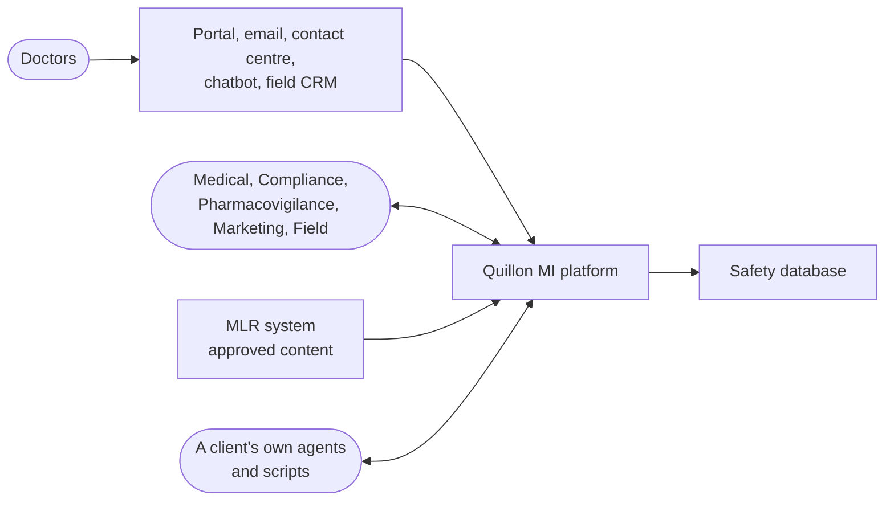

The platform serves more than one client. Quillon Biopharma is the first tenant and Marlowe Therapeutics
the second; no row, key or queue is shared between them.

## The four planes

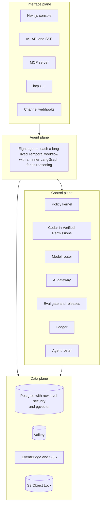

| Plane | Owns | Modules |
|---|---|---|
| Interface | How people and other systems reach the platform | `api.py`, `v1.py`, `mcp_server.py`, `cli.py`, `ingest.py`, `web/` |
| Agent | Goals, plans, tools, hand-offs | `agents.py`, `plan.py`, `sentinel.py`, `outreach.py`, `supervisor.py`, `insight.py`, `guardian.py`, `improver.py` |
| Control | What no agent may do, who may do what, which model, what it costs, whether a release is better | `kernel.py`, `graph.py`, `authz.py`, `router.py`, `gateway.py`, `releases.py`, `ledger.py` |
| Data | State, search, events, the archive | `store.py`, `db.py`, `retrieval.py`, `cache.py`, `events.py` |

## The agents

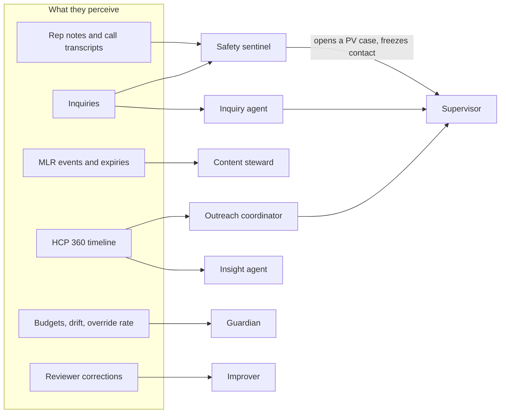

`world/agents.toml` holds one row per agent: its goal, what it perceives, what it does alone, what it only
proposes, what it never does and which model class it uses. `GET /api/agents` joins each row with its
calls and cost, and the Agents page shows it (ADR 0030). The rule underneath: **an agent acts alone only in
the direction that lowers risk.** Sending, contacting and promoting are proposals. Overriding the kernel,
assessing causality and raising anyone's autonomy are never available.

## Act 1: one question, answered safely

### 1. Who is asking, and for which client?

A question arrives, and the first thing the platform needs is an identity and a tenant, both from a signed
token and never from a header the caller controls.

- `auth.py` verifies the token against the identity provider's keys and takes the tenant from it (ADR 0010).
- `db.py` sets `app.tenant_id` on every connection and Postgres row-level security does the rest (ADR 0009).
- Cedar refuses a crossing between tenants (`policies/cedar/tenants.cedar`, ADR 0011).

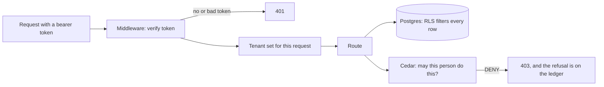

Tests: every route needs a token, every table has row-level security, and a tenant B user gets nothing of
tenant A's through the API, MCP or the CLI.

### 2. It may hide an adverse event or an injection

`rules.py` screens every message with keywords that never depend on a model, and the safety agent quotes
the passage. A possible adverse event goes to pharmacovigilance whatever else the message asks, and the
model never sees it again. The **policy kernel** (`kernel.py`, from the routing table in `graph.py`) is
what makes this hold: it checks every step an agent plans against the table, and any plan that would skip
a safety step is refused (ADR 0013).

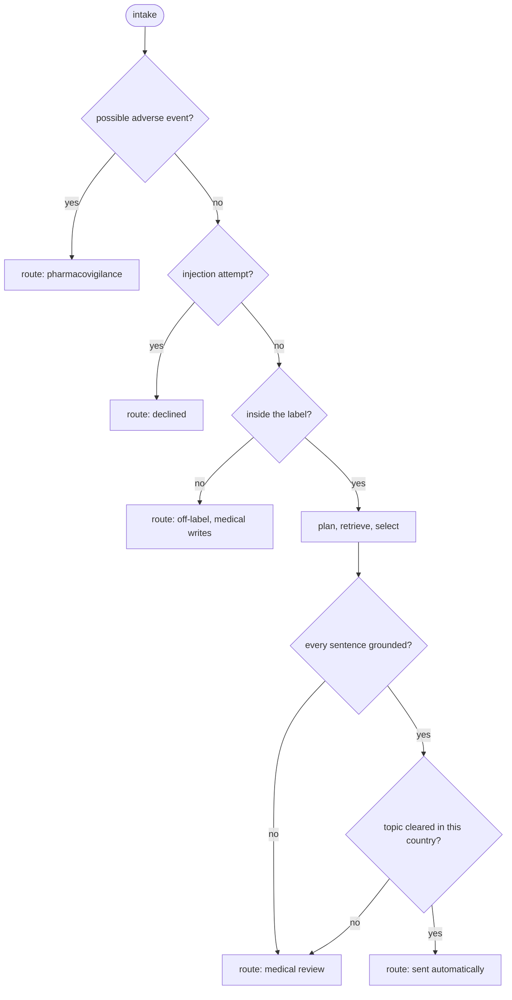

The diagram is a picture of `graph.ROUTING`, and `graph.asl()` emits the same table as a Step Functions
definition. A new rule is one row in that table, never an edge somewhere else.

### 3. The inquiry agent plans

The inquiry agent splits the message into questions, retrieves, selects blocks, checks that every
question is covered and tries once more if not (`plan.py`, a LangGraph graph; ADR 0014). It is a bounded
loop: it cannot run more than a fixed number of cycles, and the kernel checks every transition. The model
chooses block ids. It never writes a sentence a doctor reads (ADR 0002).

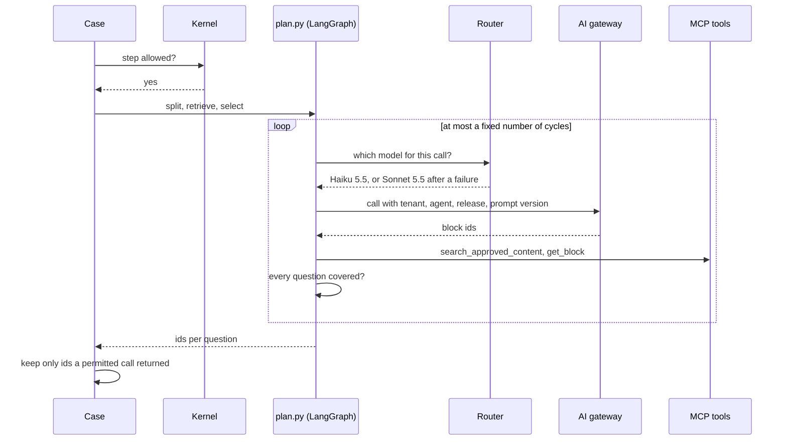

Model routing (`router.py`, ADR 0008): Haiku 5.5 is the default for high-volume work and Sonnet 5.5 takes
planning, arbitration and synthesis. A schema failure escalates once to Sonnet, then goes to a person.
`.claude/hooks/model_allowlist.py` and `tests/test_claude_config.py` refuse any other model id (ADR 0007).

### 4. What may we say?

`retrieval.py` searches approved content in two stages (ADR 0012). The **facet filter** (tenant, product,
country, population, topic, language, approval state) is a hard gate: nothing outside it is ever a
candidate. Inside it, Postgres full-text and pgvector ranks are fused by reciprocal rank fusion. Embeddings
come from `embeddings.py`, a port with a local multilingual model by default, so no key is needed and the
provider is a config choice. Vectors store the model id and dimension, so two models never mix.

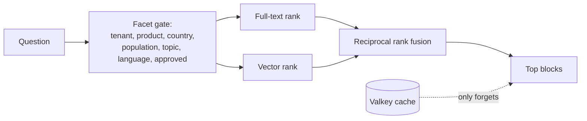

`retrieval_eval.py` scores recall at k on `world/retrieval.toml`, including other-language questions, and
the gate fails if hybrid falls below its thresholds. A mutant that drops the facet gate is killed.

### 5. Prove every sentence

`grounding.compose` places the selected blocks verbatim between fixed templates. `grounding.verify` checks
each sentence against the content store as it is now, for that product and country. It runs again at the
instant of sending, so a block withdrawn while a draft waited can never go out.

### 6. May it go alone?

The autonomy ladder decides. Only an on-label question, fully covered by current content, on a topic
Compliance has cleared for that country, is sent without a person. Cedar decides every action that follows.

| Agent | Acts alone | Proposes | Never |
|---|---|---|---|
| Safety sentinel | opens a PV case, freezes contact | nothing | assesses causality |
| Inquiry agent | plans, retrieves, selects, asks a clarifying question | drafts outside cleared topics | writes medical text |
| Outreach coordinator | holds a duplicate or conflicting send | every new contact | contacts without consent |
| Content steward | pulls impacted drafts back to review | content requests | edits content |
| Insight agent | writes traced digests for internal teams | themes for Medical Affairs | anything to a doctor |
| Guardian | trips a kill switch, lowers autonomy | raising it back | raises autonomy |
| Improver | runs candidates against the gate | a new prompt or router | promotes anything |
| Supervisor | assigns, breaks ties by policy | conflicts it cannot settle | overrides the kernel |

### 7. Record it so nobody can edit it

`ledger.py` hashes every entry with its predecessor, stores it in Postgres and copies it to an S3 Object
Lock bucket (compliance mode, ten years), and signs the head with KMS every tenth entry (ADR 0005). Personal
data in an entry is sealed under a key per person, so erasing a person deletes the key and leaves the chain
intact (`privacy.py`, ADR 0015).

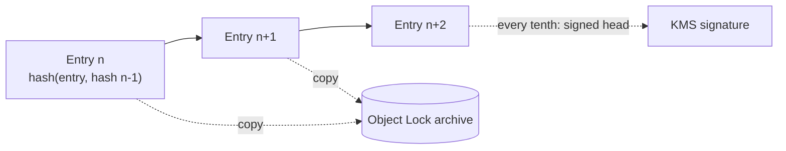

## Act 2: always on

### 8. A reviewer takes two days

A case that needs a reviewer is a Temporal workflow that waits (`workflows.py`, ADR 0016, 0017). Temporal's
history is the only durable record of where it is. A worker crash resumes the case where it stopped and
finishes it once. An SLA timer escalates a case nobody has taken. Approval takes the reviewer's password
again, which is the electronic signature in the 21 CFR Part 11 sense.

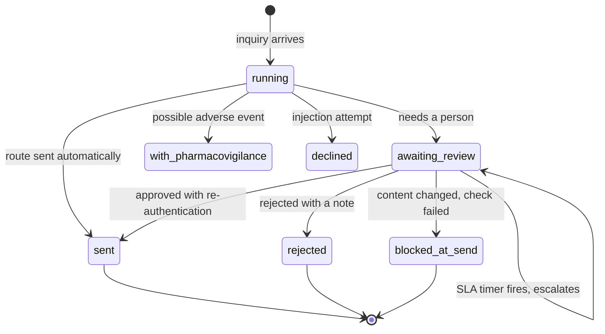

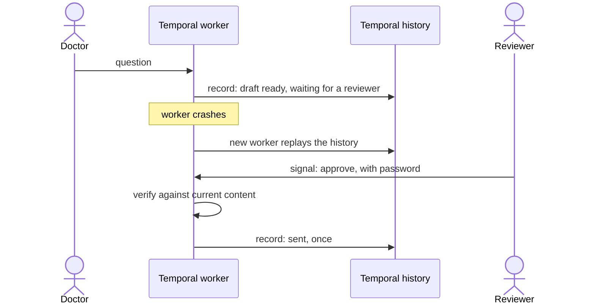

### 9. A block is withdrawn mid-review

The content steward listens for `ContentWithdrawn`, pulls every impacted draft back to review, re-verifies
and evicts the cache (ADR 0018). The cache only ever forgets: a stale entry can make a case slower, never
different.

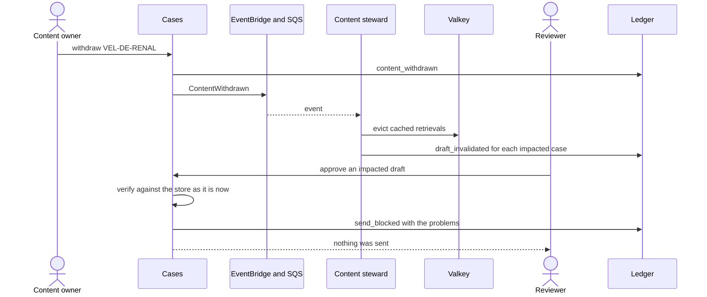

### 10. The provider fails, and finance asks what each tenant costs

Every model call goes through `gateway.py`, a thin gateway of our own that speaks the Anthropic Messages
API (ADR 0019). It holds a virtual key per tenant and agent, budgets, failover between providers and a
spend log row for every call tagged with tenant, agent, release, prompt version and case. The Agent SDK is
pointed at it with `ANTHROPIC_BASE_URL`, so even tool-using calls are metered. Delivery is at least once, so
every consumer is idempotent and a message that keeps failing lands in a dead-letter queue with replay
(ADR 0020).

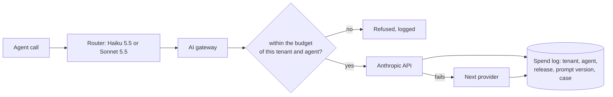

## Act 3: one doctor, many channels, many agents

### 11. Three teams are about to message the same doctor

`ingest.py` accepts events from the CRM, marketing, the contact centre and the portal, each signed with an
HMAC and landed once (ADR 0021). `identity.py` resolves a channel's own id to one doctor, and an unknown
handle stays unlinked rather than guessed (ADR 0022). `hcp360.py` joins the result into one timeline per
doctor. That record is the agents' shared memory.

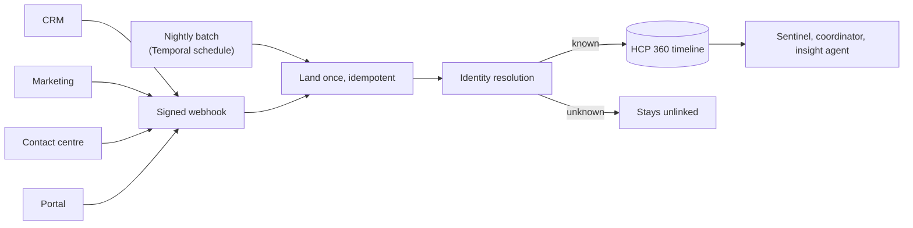

### 12. Who contacts the doctor next?

The outreach coordinator checks each planned touch against consent, the country's cap, open medical cases
and whether its content is still current. It holds or proposes, and writes the rule and its reason
(`outreach.py`). When two agents disagree, the supervisor settles it by policy and never by asking a model
(`supervisor.py`, ADR 0023). An open medical case blocks promotion.

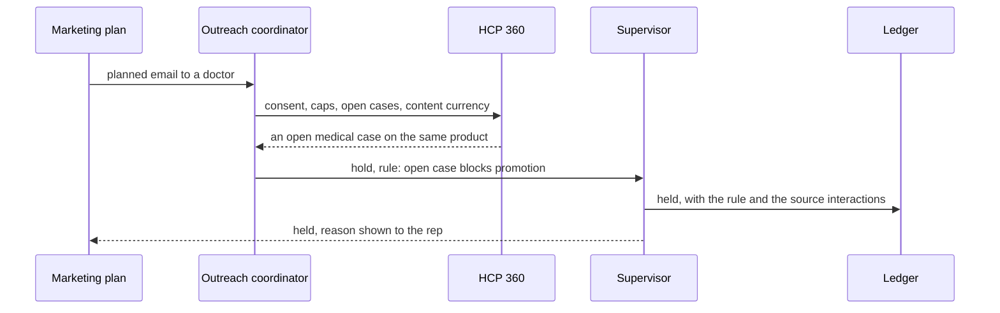

### 13. A rep's CRM note mentions a rash

The sentinel reads every interaction on every channel, so nobody has to ask it. It opens a pharmacovigilance
case and freezes outreach to that doctor and product, which are both risk-reducing actions and so are
taken alone (`sentinel.py`, ADR 0024).

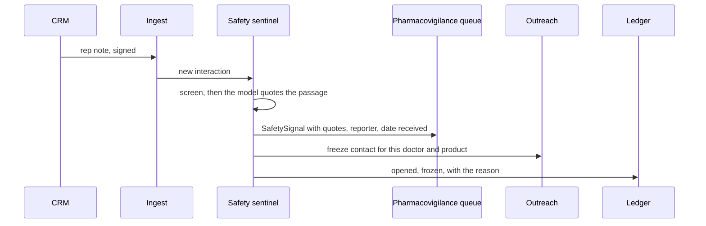

### 14. What are doctors raising across channels?

The insight agent clusters what several doctors keep raising. A theme needs at least two doctors and names
its sources but never quotes them, and it is for internal teams only (`insight.py`).

## Act 4: it improves, and proves it

### 15. Self-improvement, proven per release

A **release** pins the prompt versions, the router, the retrieval setup and the policy table, and gets a
hash for an id (`releases.py`, ADR 0025). Every call, trace and case carries its release id. Corrections
become proposals through the improver, which promotes nothing (ADR 0026).

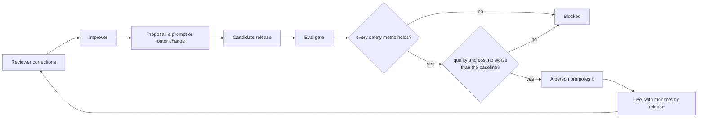

Safety metrics are absolute: adverse-event recall 1.0, zero ungrounded sentences, zero unsafe automatic
sends, zero calls off the allowlist. Quality and cost are compared with the baseline release. A run that
failed its gate can never be the baseline. The Releases page shows each metric across releases and how live
cases behaved under each.

### 16. The guardian and the traces

The guardian watches budgets, drift and the reviewers' override rate. It trips a country's kill switch or
lowers an agent's autonomy on its own and cannot raise either (`guardian.py`, ADR 0026). `redteam.py`
holds attacks the rule floor must catch whatever a model says. Every case is one trace in OpenTelemetry's
GenAI conventions with personal data redacted, exported to Phoenix locally or Langfuse Cloud when its keys
are set (`tracing.py`, ADR 0027).

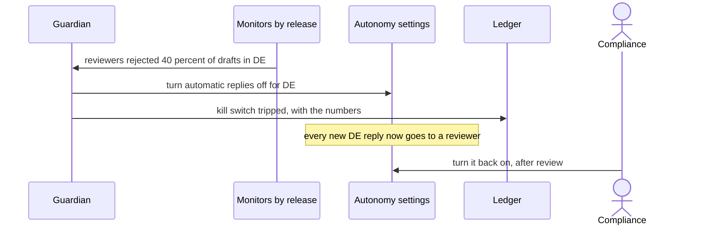

### 17. Interfaces for staff and their own agents

The console, `/v1`, MCP and the `hcp` CLI share one front door: one middleware, a verified token, the
tenant from the token and a per-user rate limit (ADR 0028). MCP is a Cedar decision per tool.

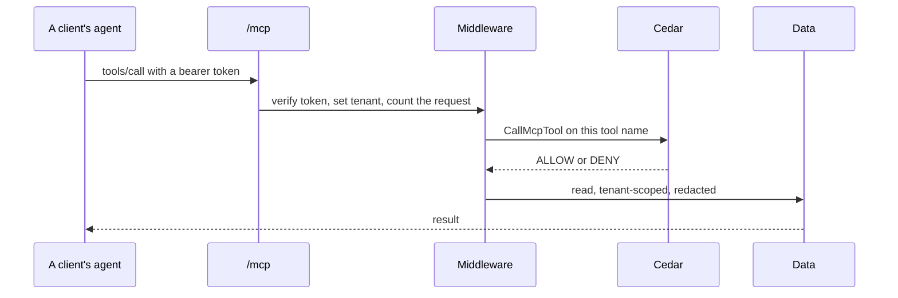

### 18. Ship it

`deploy/stack.py` is one CDK stack: Aurora Postgres, ElastiCache, Cognito, Verified Permissions, a locked
ledger bucket and a KMS key per tenant, and an ECS Fargate service each for the API and the worker. It
synthesizes with cdk-nag and zero findings, and is never deployed from here (ADR 0029, 0031).

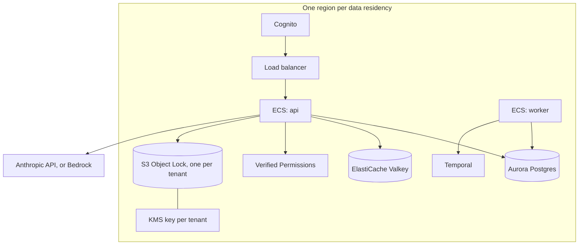

GitHub Actions runs the gate, SAST, an SBOM, secret scanning and a dependency audit. The harness the
team works in is part of the system too: the Agent SDK options in `agents._options` keep settings,
plugins and slash commands out of a call, the eval harness is `evals.py`, and `.claude/` holds the hooks
and rules that stop a bad edit before it lands.

## Trust boundaries

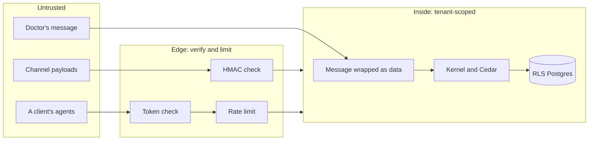

| Threat | Defence | Test or mutant |
|---|---|---|
| A prompt injection in a message | wrapped as data, rule floor, kernel | red-team corpus |
| A reply with a sentence nobody approved | id-only selection, verify twice | grounding tests, mutants |
| One tenant reads another's rows | token tenant, RLS, Cedar | isolation tests |
| A past entry is edited | hash chain, Object Lock | tamper test |
| A model outside the two allowed | hook, router, gate metric | allowlist tests |
| A signed-in user changes their own role | client cannot write custom attributes | deploy test |

## Module map

| Module | Owns | Tested by |
|---|---|---|
| `world.py` | The synthetic world from `world/*.toml` | `tests/test_world.py` |
| `graph.py`, `kernel.py` | Routing table, engine, policy kernel | `tests/test_graph.py`, `tests/test_kernel.py` |
| `rules.py`, `guards.py` | Keyword screens, label scope, tool guards | `tests/test_rules.py` |
| `agents.py`, `plan.py`, `router.py` | Agent specs, the planning graph, model choice | `tests/test_model_policy.py` |
| `retrieval.py`, `embeddings.py`, `cache.py` | Hybrid retrieval, the embeddings port, the cache | `tests/test_retrieval.py` |
| `grounding.py` | Composing and verifying replies | `tests/test_grounding.py` |
| `cases.py`, `workflows.py`, `activities.py`, `durable.py`, `worker.py` | A case and its durable life | `tests/test_flow.py` |
| `ledger.py`, `privacy.py` | The chain, the archive, erasure | `tests/test_flow.py` |
| `auth.py`, `authz.py`, `db.py`, `store.py` | Identity, permissions, tenancy, storage | `tests/test_auth.py` |
| `gateway.py`, `releases.py`, `evals.py` | Metering, releases, the gate | `tests/test_gateway.py` |
| `ingest.py`, `identity.py`, `hcp360.py` | Channels, identity, the shared memory | `tests/test_ingest.py` |
| `sentinel.py`, `outreach.py`, `supervisor.py`, `insight.py` | Perception and coordination | `tests/test_perception.py` |
| `guardian.py`, `improver.py`, `redteam.py` | Limits and improvement | `tests/test_guardian.py` |
| `tracing.py`, `observe.py` | Traces, metrics, logs | `tests/test_tracing.py` |
| `api.py`, `v1.py`, `mcp_server.py`, `cli.py`, `ratelimit.py` | The interfaces | `tests/test_console.py` |

## Data

| Store | Holds |
|---|---|
| Postgres `documents` | Content, cases, HCPs, touches, proposals: one JSON row each, tenant-scoped by RLS |
| Postgres pgvector index | One vector per approved block, with its model id and dimension |
| Postgres spend log | One row per model call |
| Postgres `eval_runs` | One row per eval run, per release |
| Valkey | Retrieval cache, rate-limit counters, idempotency keys |
| Object Lock bucket | One object per ledger entry, retained ten years |
| Temporal history | Where every running case is |
| Verified Permissions | The Cedar files in `policies/cedar/` |

## Running it

```bash
make up          # Floci, Postgres, Temporal, Valkey, and every resource
make check       # tests, evals, mutants, prose, web build, mermaid
make serve       # console on http://localhost:8765
make walkthrough # recapture docs/product-walkthrough-shots
LIVE=1 uv run python -m hcpagents run inq-101   # one live case
```
