# Architecture walkthrough

This is a system of agents. It is not one agent. It is not a workflow with agents as steps. Eight agents, each with its own goal, live for a long time. They watch events from every channel. They share state to work together. They act alone only where that lowers risk. They improve from what reviewers correct. A control plane that Compliance can read limits all of them.

The walkthrough follows one doctor through the platform in four acts. A layer appears at the moment the step before it breaks without it. Each step names the problem, the choice, the code and the test.

## The system at a glance

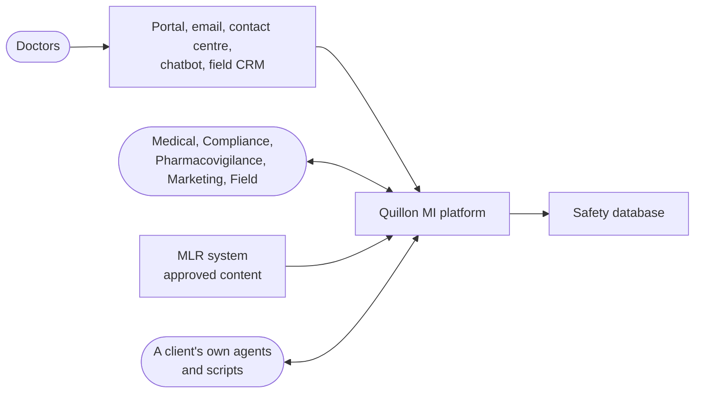

The platform serves more than one client. Quillon Biopharma is the first tenant. Marlowe Therapeutics is the second. They share no row, key or queue.

## The four planes

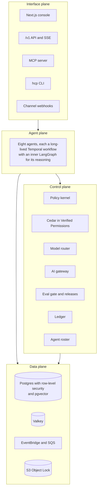

| Plane | Owns | Modules |
|---|---|---|
| Interface | How people and other systems reach the platform | `api.py`, `v1.py`, `mcp_server.py`, `cli.py`, `ingest.py`, `web/` |
| Agent | Goals, plans, tools, hand-offs | `agents.py`, `plan.py`, `sentinel.py`, `outreach.py`, `supervisor.py`, `insight.py`, `guardian.py`, `improver.py` |
| Control | What no agent may do, who may do what, which model, what it costs, whether a release is better | `kernel.py`, `graph.py`, `authz.py`, `router.py`, `gateway.py`, `releases.py`, `ledger.py` |
| Data | State, search, events, the archive | `store.py`, `db.py`, `retrieval.py`, `cache.py`, `events.py` |

## The agents

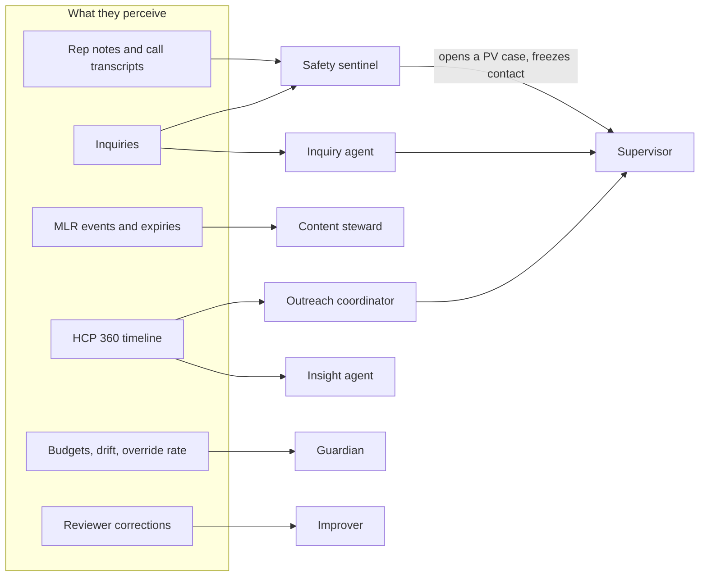

`world/agents.toml` holds one row per agent. The row lists its goal, what it sees, what it does alone, what it only proposes, what it never does and which model class it uses. `GET /api/agents` joins each row with its calls and cost. The Agents page shows it (ADR 0030). The rule underneath: **an agent acts alone only in the direction that lowers risk.** Sending, contacting and promoting are proposals. Overriding the kernel, judging cause and raising anyone's autonomy are never available.

## Act 1: one question, answered safely

### 1. Who is asking, and for which client?

A question arrives. The platform first needs an identity and a tenant. Both come from a signed token. They never come from a header the caller controls.

- `auth.py` verifies the token against the identity provider's keys and takes the tenant from it (ADR 0010).
- `db.py` sets `app.tenant_id` on every connection and Postgres row-level security does the rest (ADR 0009).
- Cedar refuses a crossing between tenants (`policies/cedar/tenants.cedar`, ADR 0011).

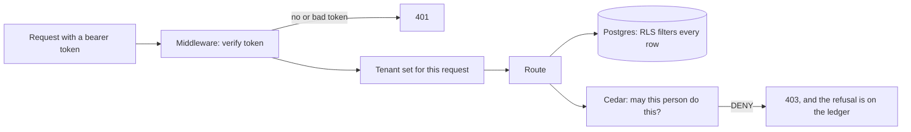

Tests: every route needs a token. Every table has row-level security. A tenant B user gets nothing of tenant A's through the API, MCP or the CLI.

### 2. It may hide an adverse event or an injection

`rules.py` screens every message with keywords. They never depend on a model. The safety agent quotes the passage. A possible adverse event goes to pharmacovigilance whatever else the message asks. The model never sees it again. The **policy kernel** makes this hold (`kernel.py`, from the routing table in `graph.py`). It checks every step an agent plans against the table. It refuses any plan that would skip a safety step (ADR 0013).

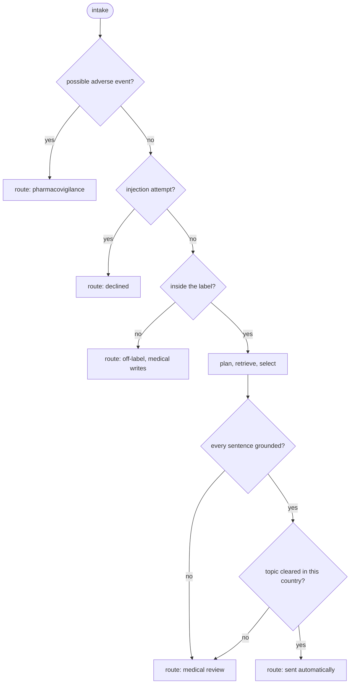

The diagram is a picture of `graph.ROUTING`. `graph.asl()` emits the same table as a Step Functions definition. A new rule is one row in that table. It is never an edge somewhere else.

### 3. The inquiry agent plans

The inquiry agent splits the message into questions. It retrieves, selects blocks and checks that every question is covered. If not, it tries once more (`plan.py`, a LangGraph graph; ADR 0014). It is a bounded loop. It cannot run more than a fixed number of cycles. The kernel checks every transition. The model chooses block ids. It never writes a sentence a doctor reads (ADR 0002).

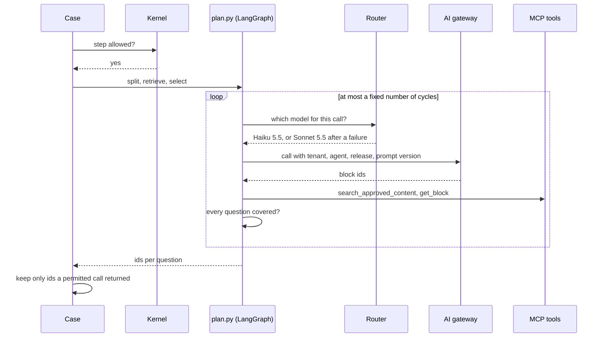

Model routing (`router.py`, ADR 0008): Haiku 5.5 is the default for high-volume work. Sonnet 5.5 takes planning, arbitration and synthesis. A schema failure goes up once to Sonnet. Then it goes to a person. `.claude/hooks/model_allowlist.py` and `tests/test_claude_config.py` refuse any other model id (ADR 0007).

### 4. What may we say?

`retrieval.py` searches approved content in two stages (ADR 0012). The **facet filter** is a hard gate. It covers tenant, product, country, population, topic, language and approval state. Nothing outside it is ever a candidate. Inside it, Postgres full-text and pgvector ranks are fused by reciprocal rank fusion. Embeddings come from `embeddings.py`. It is a port with a local multilingual model by default, so no key is needed. The provider is a config choice. Vectors store the model id and dimension, so two models never mix.

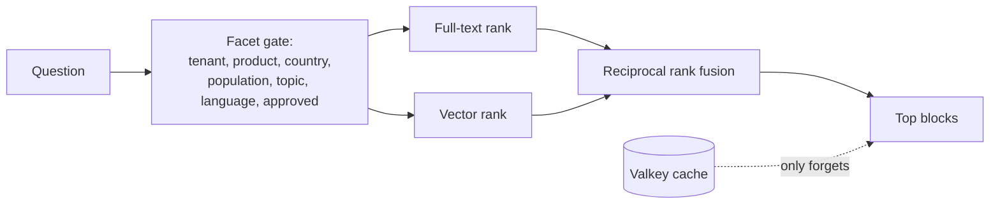

`retrieval_eval.py` scores recall at k on `world/retrieval.toml`. That includes other-language questions. The gate fails if hybrid falls below its thresholds. A mutant that drops the facet gate is killed.

### 5. Prove every sentence

`grounding.compose` places the selected blocks word for word between fixed templates. `grounding.verify` checks each sentence against the content store as it is now, for that product and country. It runs again at the moment of sending. So a block withdrawn while a draft waited can never go out.

### 6. May it go alone?

The autonomy ladder decides. A reply is sent without a person only in one case. The question is on-label. Current content fully covers it. Compliance has cleared the topic for that country. Cedar decides every action that follows.

| Agent | Acts alone | Proposes | Never |
|---|---|---|---|
| Safety sentinel | opens a PV case, freezes contact | nothing | assesses causality |
| Inquiry agent | plans, retrieves, selects, asks a clarifying question | drafts outside cleared topics | writes medical text |
| Outreach coordinator | holds a duplicate or conflicting send | every new contact | contacts without consent |
| Content steward | pulls impacted drafts back to review | content requests | edits content |
| Insight agent | writes traced digests for internal teams | themes for Medical Affairs | anything to a doctor |
| Guardian | trips a kill switch, lowers autonomy | raising it back | raises autonomy |
| Improver | runs candidates against the gate | a new prompt or router | promotes anything |
| Supervisor | assigns, breaks ties by policy | conflicts it cannot settle | overrides the kernel |

### 7. Record it so nobody can edit it

`ledger.py` hashes every entry with the one before it. It stores the entry in Postgres. It copies it to an S3 Object Lock bucket (compliance mode, ten years). It signs the head with KMS every tenth entry (ADR 0005). Personal data in an entry is sealed under a key per person. So erasing a person deletes the key and leaves the chain intact (`privacy.py`, ADR 0015).

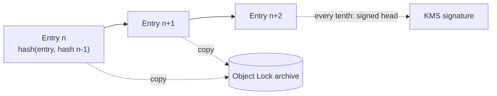

## Act 2: always on

### 8. A reviewer takes two days

A case that needs a reviewer is a Temporal workflow that waits (`workflows.py`, ADR 0016, 0017). Temporal's history is the only durable record of where the case is. If a worker crashes, the case resumes where it stopped. It finishes once. An SLA timer escalates a case nobody has taken. Approval takes the reviewer's password again. That is the electronic signature in the 21 CFR Part 11 sense.

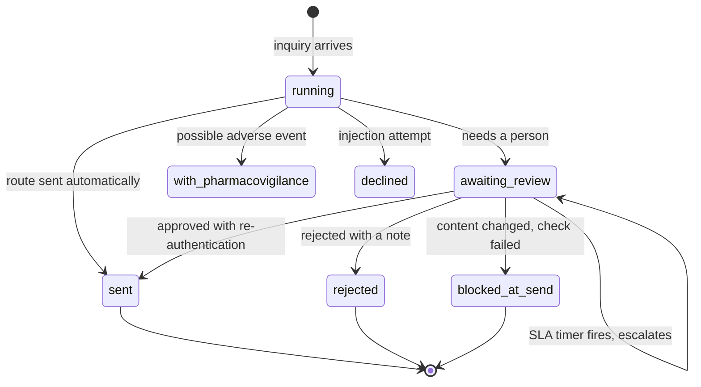

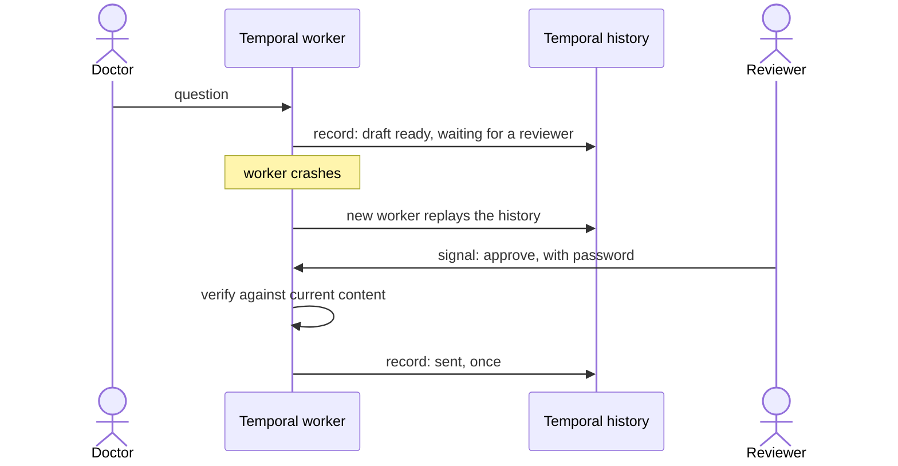

### 9. A block is withdrawn mid-review

The content steward listens for `ContentWithdrawn`. It pulls every impacted draft back to review, checks it again and evicts the cache (ADR 0018). The cache only ever forgets. A stale entry can make a case slower. It can never make it different.

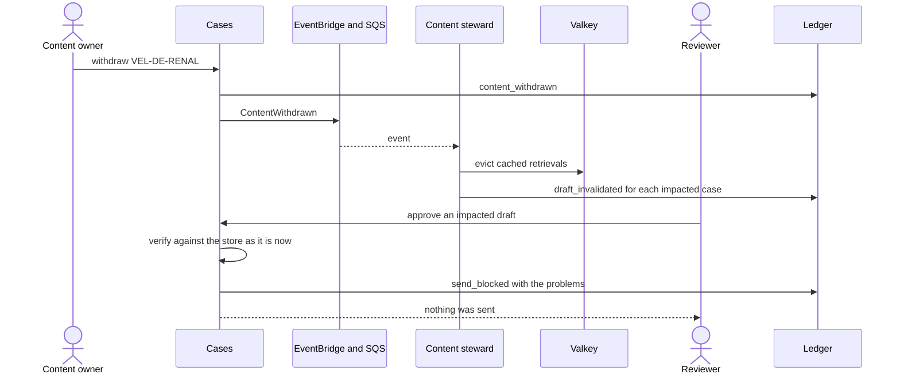

### 10. The provider fails, and finance asks what each tenant costs

Every model call goes through `gateway.py`. It is a thin gateway of our own that speaks the Anthropic Messages API (ADR 0019). It holds a virtual key per tenant and agent, budgets and failover between providers. It writes a spend log row for every call. The row is tagged with tenant, agent, release, prompt version and case. The Agent SDK points at it with `ANTHROPIC_BASE_URL`, so even tool-using calls are metered. Delivery is at least once, so every consumer is idempotent. A message that keeps failing lands in a dead-letter queue with replay (ADR 0020).

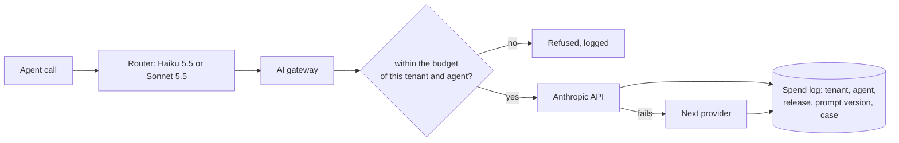

## Act 3: one doctor, many channels, many agents

### 11. Three teams are about to message the same doctor

`ingest.py` accepts events from the CRM, marketing, the contact centre and the portal. Each is signed with an HMAC and landed once (ADR 0021). `identity.py` resolves a channel's own id to one doctor. An unknown handle stays unlinked rather than guessed (ADR 0022). `hcp360.py` joins the result into one timeline per doctor. That record is the agents' shared memory.

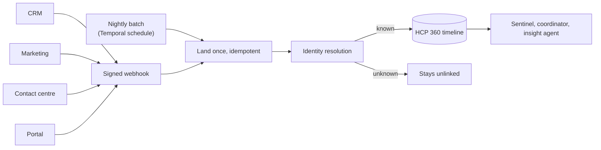

### 12. Who contacts the doctor next?

The outreach coordinator checks each planned touch against consent, the country's cap, open medical cases and whether its content is still current. It holds or proposes. It writes the rule and its reason (`outreach.py`). When two agents disagree, the supervisor settles it by policy. It never asks a model (`supervisor.py`, ADR 0023). An open medical case blocks promotion.

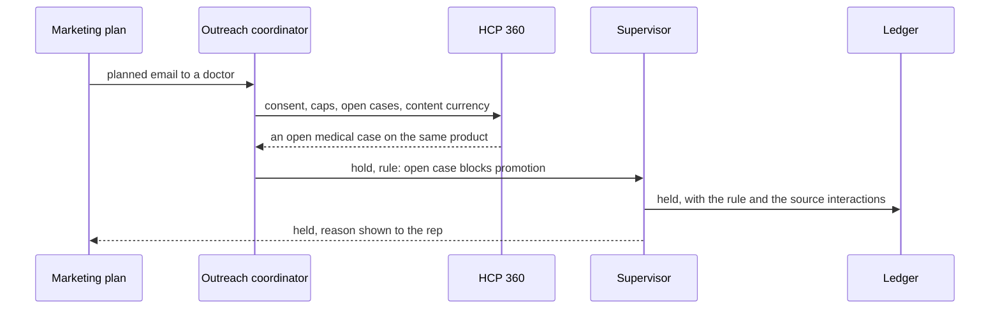

### 13. A rep's CRM note mentions a rash

The sentinel reads every interaction on every channel, so nobody has to ask it. It opens a pharmacovigilance case. It freezes outreach to that doctor and product. Both actions lower risk, so it takes them alone (`sentinel.py`, ADR 0024).

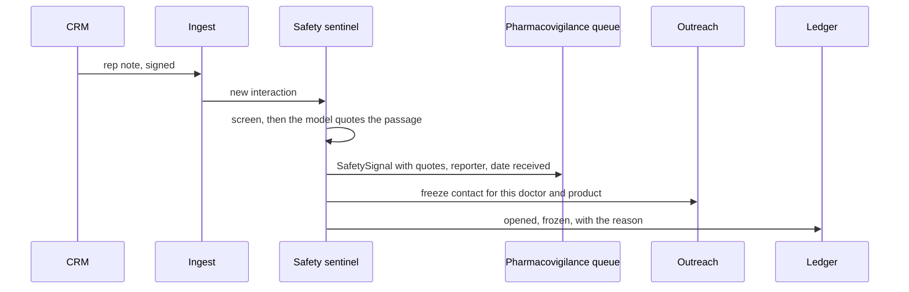

### 14. What are doctors raising across channels?

The insight agent clusters what several doctors keep raising. A theme needs at least two doctors. It names its sources but never quotes them. It is for internal teams only (`insight.py`).

## Act 4: it improves, and proves it

### 15. Self-improvement, proven per release

A **release** pins the prompt versions, the router, the retrieval setup and the policy table. It gets a hash for an id (`releases.py`, ADR 0025). Every call, trace and case carries its release id. Corrections become proposals through the improver. The improver promotes nothing (ADR 0026).

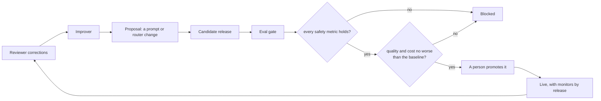

Safety metrics are absolute: adverse-event recall 1.0, zero ungrounded sentences, zero unsafe automatic sends, zero calls off the allowlist. Quality and cost are compared with the baseline release. A run that failed its gate can never be the baseline. The Releases page shows each metric across releases. It also shows how live cases behaved under each.

### 16. The guardian and the traces

The guardian watches budgets, drift and the reviewers' override rate. It can trip a country's kill switch or lower an agent's autonomy on its own. It cannot raise either (`guardian.py`, ADR 0026). `redteam.py` holds attacks that the rule floor must catch whatever a model says. Every case is one trace in OpenTelemetry's GenAI conventions, with personal data redacted. Traces go to Phoenix locally, or to Langfuse Cloud when its keys are set (`tracing.py`, ADR 0027).

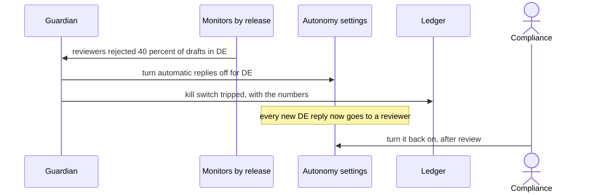

### 17. Interfaces for staff and their own agents

The console, `/v1`, MCP and the `hcp` CLI share one front door. It has one middleware, a verified token, the tenant from the token and a per-user rate limit (ADR 0028). MCP is a Cedar decision per tool.

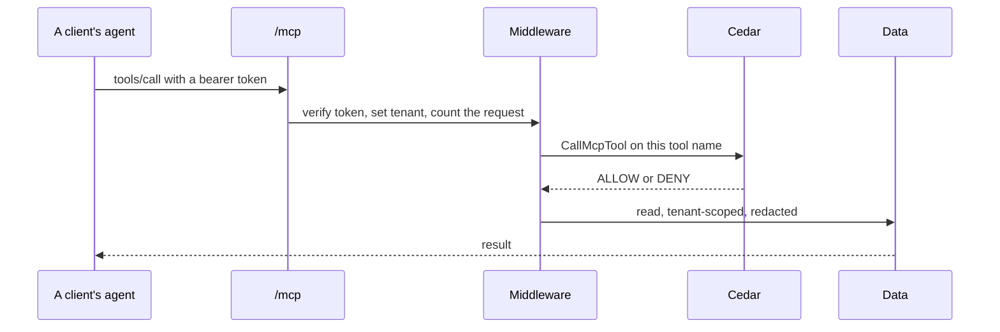

### 18. Ship it

`deploy/stack.py` is one CDK stack. It holds Aurora Postgres, ElastiCache, Cognito, Verified Permissions, a locked ledger bucket and a KMS key per tenant. It also holds an ECS Fargate service each for the API and the worker. It synthesizes with cdk-nag and zero findings. It is never deployed from here (ADR 0029, 0031).

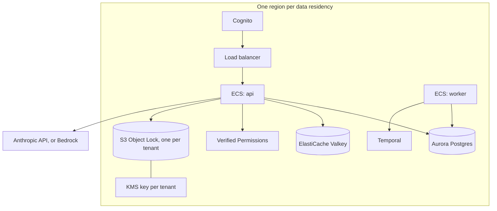

GitHub Actions runs the gate, SAST, an SBOM, secret scanning and a dependency audit. The harness the team works in is part of the system too. The Agent SDK options in `agents._options` keep settings, plugins and slash commands out of a call. The eval harness is `evals.py`. `.claude/` holds the hooks and rules that stop a bad edit before it lands.

## Trust boundaries

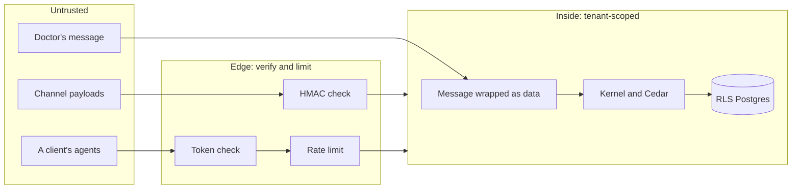

| Threat | Defence | Test or mutant |
|---|---|---|
| A prompt injection in a message | wrapped as data, rule floor, kernel | red-team corpus |
| A reply with a sentence nobody approved | id-only selection, verify twice | grounding tests, mutants |
| One tenant reads another's rows | token tenant, RLS, Cedar | isolation tests |
| A past entry is edited | hash chain, Object Lock | tamper test |
| A model outside the two allowed | hook, router, gate metric | allowlist tests |
| A signed-in user changes their own role | client cannot write custom attributes | deploy test |

## Module map

| Module | Owns | Tested by |
|---|---|---|
| `world.py` | The synthetic world from `world/*.toml` | `tests/test_world.py` |
| `graph.py`, `kernel.py` | Routing table, engine, policy kernel | `tests/test_graph.py`, `tests/test_kernel.py` |
| `rules.py`, `guards.py` | Keyword screens, label scope, tool guards | `tests/test_rules.py` |
| `agents.py`, `plan.py`, `router.py` | Agent specs, the planning graph, model choice | `tests/test_model_policy.py` |
| `retrieval.py`, `embeddings.py`, `cache.py` | Hybrid retrieval, the embeddings port, the cache | `tests/test_retrieval.py` |
| `grounding.py` | Composing and verifying replies | `tests/test_grounding.py` |
| `cases.py`, `workflows.py`, `activities.py`, `durable.py`, `worker.py` | A case and its durable life | `tests/test_flow.py` |
| `ledger.py`, `privacy.py` | The chain, the archive, erasure | `tests/test_flow.py` |
| `auth.py`, `authz.py`, `db.py`, `store.py` | Identity, permissions, tenancy, storage | `tests/test_interfaces.py` |
| `gateway.py`, `releases.py`, `evals.py` | Metering, releases, the gate | `tests/test_gateway.py` |
| `ingest.py`, `identity.py`, `hcp360.py` | Channels, identity, the shared memory | `tests/test_ingest.py` |
| `sentinel.py`, `outreach.py`, `supervisor.py`, `insight.py` | Perception and coordination | `tests/test_perception.py` |
| `guardian.py`, `improver.py`, `redteam.py` | Limits and improvement | `tests/test_guardian.py` |
| `tracing.py`, `observe.py` | Traces, metrics, logs | `tests/test_tracing.py` |
| `api.py`, `v1.py`, `mcp_server.py`, `cli.py`, `ratelimit.py` | The interfaces | `tests/test_console.py` |

## Data

| Store | Holds |
|---|---|
| Postgres `documents` | Content, cases, HCPs, touches, proposals: one JSON row each, tenant-scoped by RLS |
| Postgres pgvector index | One vector per approved block, with its model id and dimension |
| Postgres spend log | One row per model call |
| Postgres `eval_runs` | One row per eval run, per release |
| Valkey | Retrieval cache, rate-limit counters, idempotency keys |
| Object Lock bucket | One object per ledger entry, retained ten years |
| Temporal history | Where every running case is |
| Verified Permissions | The Cedar files in `policies/cedar/` |

## Running it

```bash
make up          # Floci, Postgres, Temporal, Valkey, and every resource
make check       # tests, evals, mutants, prose, web build, mermaid
make serve       # console on http://localhost:8765
make walkthrough # recapture docs/product-walkthrough-shots
LIVE=1 uv run python -m hcpagents run inq-101   # one live case
```
