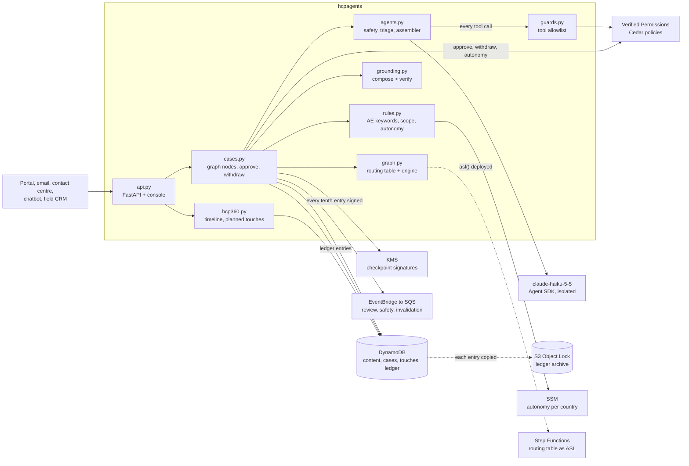
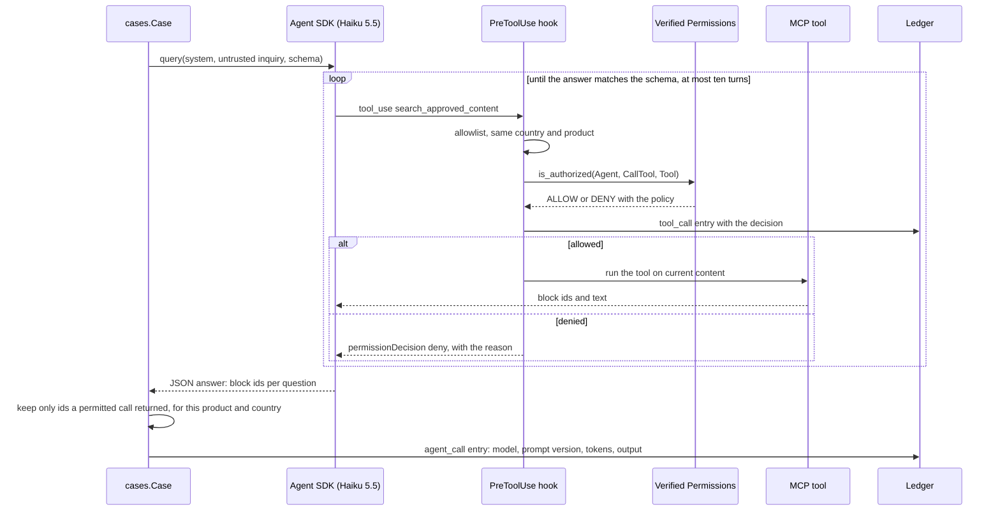
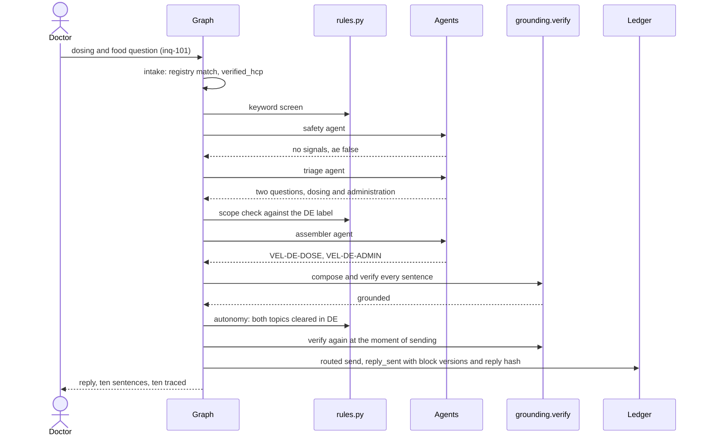
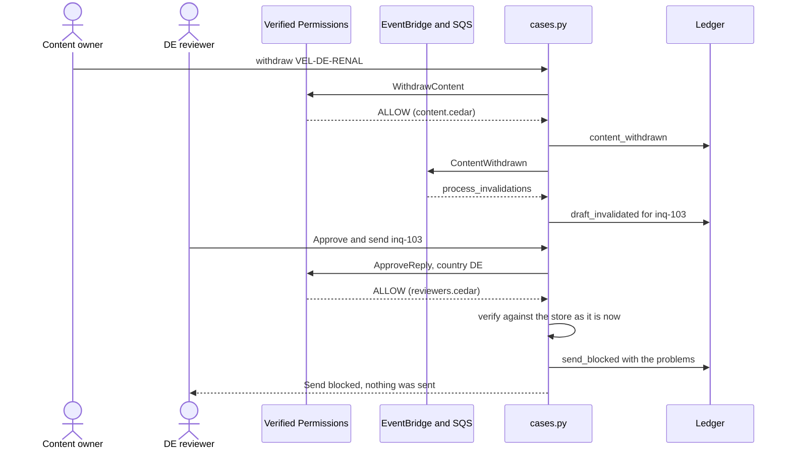
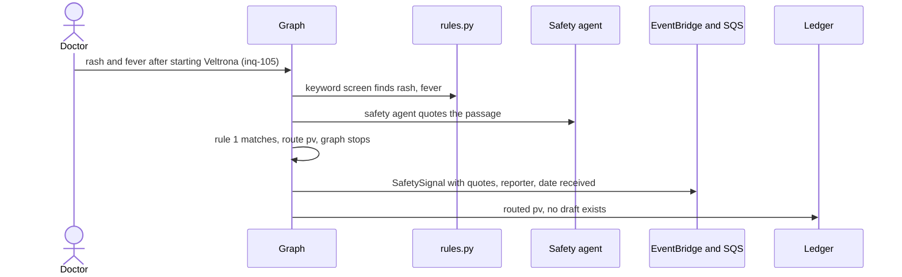

# Architecture walkthrough

One Python package, `hcpagents`, holds the platform. A FastAPI app serves the API and the Astro console
from `web/dist`. Every AWS service runs on Floci at `localhost:4566` through plain boto3 clients, so the
same code runs against AWS. Three agents on the Claude Agent SDK, all on `claude-haiku-5-5`, read and select;
plain code decides, composes and checks.



What each arrow is in the code:

- **Inbound:** `POST /api/inquiries/{id}/run` calls `cases.run`, which builds a `Case` and hands its seven
  node methods to `graph.run`. In production the channels publish to EventBridge and a consumer calls the
  same function.
- **Routing:** `graph.run` awaits each node, merges the facts it returns, and calls `graph.decide` after
  every node. `decide` walks `ROUTING` in order and returns the first match, or `None` while a fact it needs
  is unknown.
- **Model:** `cases.Case.agent` calls `agents.call`. Live, that runs the Agent SDK with the options in
  `agents._options`; in replay it loads the recording and runs its tool calls through the same guards.
- **Tool calls:** the assembler's two MCP tools (`search_approved_content`, `get_block`) sit behind a
  `PreToolUse` hook that calls `guards.pre_tool`: allowlist, same country and product as the case, then
  `authz.agent_can_call` against Verified Permissions. Every call, allowed or denied, is a ledger entry.
- **Reply:** `grounding.compose` places the selected blocks verbatim between the templates;
  `grounding.verify` checks each sentence against current blocks for that product and country.
- **Handoffs:** `cases._handoff` sends, or publishes `ReviewNeeded` or `SafetySignal` to EventBridge; rules
  route them to SQS queues for each team.
- **Ledger:** `ledger.append` hashes each entry with its predecessor, writes it to DynamoDB and to the Object
  Lock bucket, and signs the head with KMS every tenth entry.

## The agentic loop, and why it is short

Each agent is one Agent SDK `query` with a fixed system prompt, the inquiry wrapped as untrusted data, and a
JSON schema for the answer. The safety and triage agents have no tools and three turns at most. The
assembler has two read-only MCP tools and ten turns.



The loop is deliberately small. The model's whole authority is choosing which tool call to make next and
which ids to return; the graph, not the model, decides what happens with the answer.

## Flow: a question answered without a human



## Flow: content withdrawn after drafting



## Flow: a possible adverse event



The triage and assembler agents never run on this case, so there is no AI text to leak and nothing for a
reviewer to approve; `reviewers.cedar` also forbids approval on any pharmacovigilance case.

## Module map

| Module | Owns | Tested by |
|---|---|---|
| `world.py` | Loads the synthetic world from `world/*.toml`; content currency | `tests/test_world.py` |
| `graph.py` | Routing table, engine, Step Functions definition | `tests/test_graph.py` |
| `rules.py` | Adverse event and injection keywords, label scope, autonomy | `tests/test_rules.py` |
| `grounding.py` | Composing replies and per-sentence verification | `tests/test_grounding.py` |
| `guards.py` | Tool allowlist and case country and product check | `tests/test_rules.py` |
| `agents.py` | Agent specs, SDK options, replay, cost and model policy | `tests/test_model_policy.py` |
| `cases.py` | Graph nodes, handoffs, approve, reject, withdraw, autonomy | `tests/test_flow.py` |
| `ledger.py` | Hash chain, archive, signatures, tamper and restore | `tests/test_flow.py` |
| `authz.py` | Every Verified Permissions call | `tests/test_flow.py` |
| `hcp360.py` | Timeline and planned touch decisions | `tests/test_flow.py` |
| `events.py` | Publishing handoffs to EventBridge and draining the SQS queues | `tests/test_flow.py` |
| `observe.py` | CloudWatch metrics and one structured log line per case; the trace in Langfuse shape | `make check` runs every case through it |
| `infra.py` | Provisioning every Floci resource | every Floci test |
| `evals.py` | The release gate over `evals/gate.toml` | `make evals`, also run by `make check` |
| `api.py` | HTTP API and the console | `tests/test_flow.py`, `make walkthrough` |

## Data

| Table or resource | Holds |
|---|---|
| `mi-content` | Blocks: id, version, MLR reference, country, product, topic, text, validity, status |
| `mi-cases` | One document per case: inquiry, facts, trace, agent calls, draft, verification, history |
| `mi-hcp` | One joined record per doctor: registry id, consent, source system ids |
| `mi-touches` | Every touch on every HCP, past and planned |
| `mi-ledger` | The hash chain |
| Object Lock bucket | One object per ledger entry, retained ten years in compliance mode |
| `/mi/autonomy/<country>` | The kill switch and cleared topics per country |
| Verified Permissions store | The five Cedar files in `policies/cedar/` |

## Running it

```bash
make up          # Floci and every resource
make check       # tests, evals, mutants, prose, web build, mermaid
make serve       # console on http://localhost:8765
make walkthrough # recapture docs/product-walkthrough-shots
LIVE=1 uv run python -m hcpagents run inq-101   # one live case, under $0.002
```
