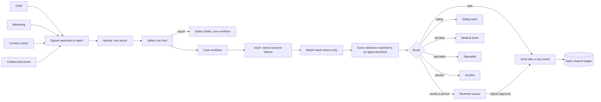
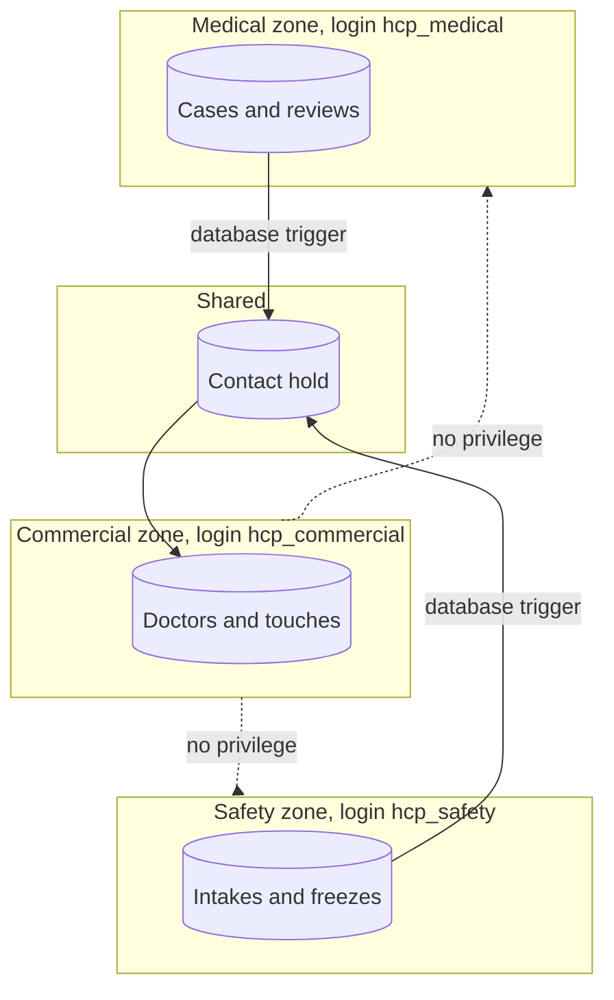
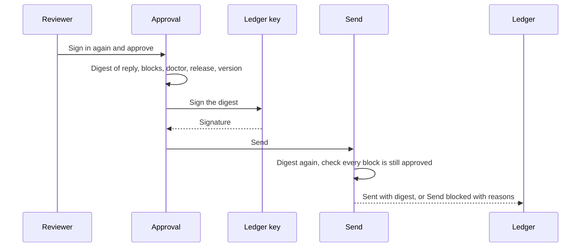
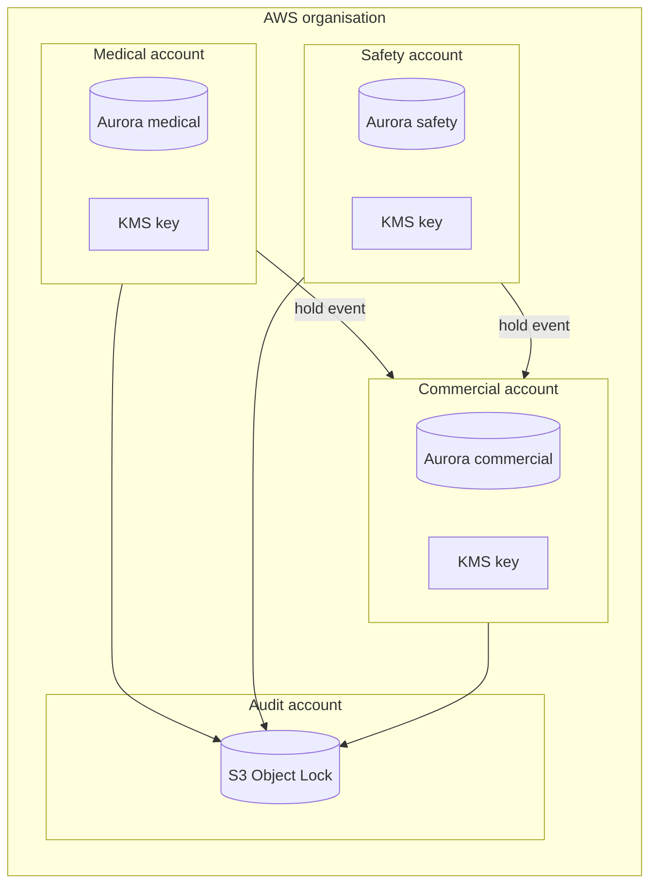

# System blueprint

This page is the picture of the whole system in one place. The [architecture walkthrough](./architecture-walkthrough.md) follows one doctor through the code, one small diagram at a time. This page shows all of it at once.

Four of the tables below are read by `tests/test_blueprint.py`. If the code changes and the table does not, the test fails.

## 1. Data flow

Four channels bring a doctor's message in. One identity resolves the doctor. A rule floor looks for a safety signal before any model reads the text. Then the case takes one of six routes.

**Legend.** A box is a step. A rounded edge label is the condition. The safety intake runs in its own workflow, so the case never waits for it. The ledger takes every decision, and each entry holds the hash of the one before it.

## 2. Data firewall

Medical, safety and commercial data live in separate database schemas. Each has its own login. The commercial login has no privilege on the other two. The only thing that crosses is a hold: a doctor, a product and a reason, with no case id and no text. The database writes the hold itself.

**Legend.** A solid arrow is the only way data crosses. A dotted arrow is a refusal by the database. Each zone has its own KMS key in the stack.

Who gets which view of a doctor. Cedar decides it, in `policies/cedar/zones.cedar`.

| Role | View | What it holds |
|---|---|---|
| medical_reviewer | medical | Cases, notes and counts |
| pv | medical | Cases, notes and counts |
| compliance | medical | Cases, notes and counts |
| mi_specialist | commercial | Profile and holds only |
| content_owner | commercial | Profile and holds only |
| field_rep | commercial | Profile and holds only |

What may be said to whom. Each content block carries a type and an audience. The search filters on the audience before it ranks anything.

| Block type | Doctor | Rep | Chatbot |
|---|---|---|---|
| PI | yes | yes | no |
| SRD | yes | no | no |
| SELF_SERVICE | no | no | yes |
| TEMPLATE | yes | yes | yes |

PI is the product information. SRD is a standard response document, for example on renal impairment, pregnancy or interactions.

## 3. Approval path

A signature covers one exact reply. The reviewer signs in again. The system makes a digest of the text, each block and its version, the doctor, the country, the release and the draft version. The ledger key signs the digest. The send makes the digest again and stops if anything moved.

**Legend.** Time runs down. A withdrawal of a block closes every draft that uses it at once, before anyone can sign it.

## 4. AWS layout

This build separates the zones inside one database cluster, with one KMS key per zone. In production each zone is its own AWS account.

**Legend.** Each box is one account. Only the hold event crosses between zones. Every account writes to the audit bucket, which cannot be changed. We only run `cdk synth` for this layout. We have not deployed separate accounts.

## 5. Every place a human decides

| Decision | Role | Code |
|---|---|---|
| Approve a reply to a doctor | medical_reviewer | `case_review.py::approve` |
| Reject a reply to a doctor | medical_reviewer | `case_review.py::reject` |
| Approve a planned email | field_rep | `outreach.py::approve` |
| Acknowledge a safety intake | pv | `safety_clock.py::acknowledge` |
| Screen an event by hand while the detector is down | pv | `safety_clock.py::send_to_manual_screening` |
| Withdraw a content block | content_owner | `case_review.py::withdraw` |
| Turn automatic replies on or off for a country | compliance | `case_review.py::set_autonomy` |
| Make a release the baseline | compliance | `releases.py::promote` |

## What this build does not do

- It does not run separate AWS accounts. It synthesises the stack only.
- The business day clock for the safety acknowledgment skips weekends. It has no holiday calendar.
- Name detection by the model works in English text only. German names rely on the names list and the title pattern.
