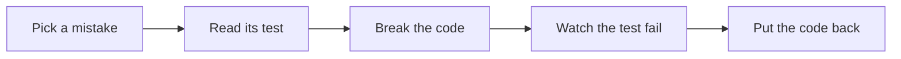

# Common mistakes

Each mistake below looks fine in a diagram. Each one fails in a real audit. The last column names the test that stops it here.

| Mistake | Why it fails | The test that catches it |
|---|---|---|
| One database for every team | Marketing can read medical cases, so a code review is the only wall | `labs/split-data-into-zones/test_zone_split.py` |
| Raw names and ids in the prompt | The model provider now holds personal data | `tests/test_wire_privacy.py` |
| Redaction that cannot be undone | The reply to the doctor has no name in it | `tests/test_live_i_phi_vault.py::test_the_same_value_gets_the_same_token_and_the_swap_reverses_exactly` |
| A model judge decides to send | A second model can be wrong in the same way | `tests/test_grounding.py` |
| The sign-off is not tied to the reply | The text can change after the click | `tests/test_approval_binding.py` |
| A reviewer reads a draft whose source was withdrawn | Review time is wasted and the draft can still be signed | `tests/test_approval_binding.py::test_a_withdrawal_closes_the_draft_before_a_reviewer_can_sign_it` |
| Every audience gets the same blocks | A rep can quote an answer meant for doctors | `tests/test_content_firewall.py` |
| Safety waits behind the answer | A slow or failed model delays a report with a legal clock | `tests/test_safety_floor.py` |
| A detector that fails drops the event | A silent outage hides adverse events | `tests/test_safety_clock.py` |

How to use this page, in one picture:

How to use this page: pick the row that looks most like your design. Read the test. Then break the code it guards and watch the test fail.
