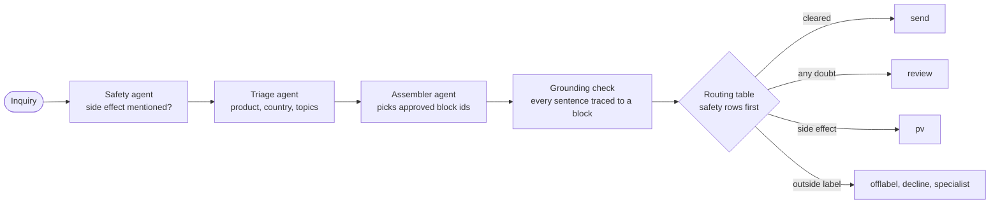
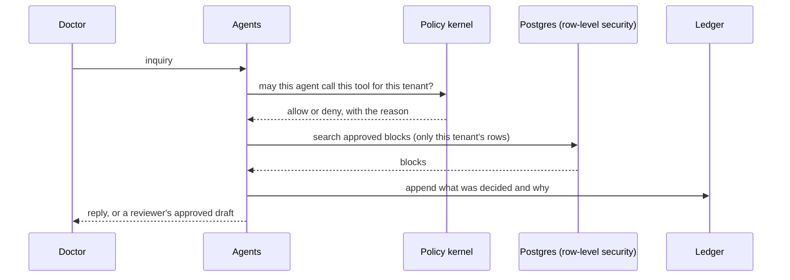

# Walkthrough

## The problem

A doctor asks a drugs company a question: can this medicine be used in pregnancy, what is the dose for a
child, is it safe with another drug. Three things can go wrong, and each one is a regulatory event.

- **A wrong or invented answer.** A sentence nobody approved reaches a doctor.
- **A missed safety report.** The question mentions a side effect, and nobody files it with
  pharmacovigilance.
- **A leak.** One client's content, or one doctor's history, shows up in another client's reply.

An agent that writes the reply makes all three easy. So the platform never lets a model write what a
doctor reads. The model picks approved content blocks and states facts; a table of rules decides where the
case goes; code checks every sentence against a block.

## What you build

A multi-tenant platform that answers doctors' inquiries and routes every case to one of six places.

| Route | Meaning |
|---|---|
| `send` | Cleared for an automatic reply |
| `review` | A medical reviewer reads the draft first |
| `offlabel` | The question is outside the approved use |
| `pv` | A possible side effect goes to pharmacovigilance |
| `decline` | Nothing can be said |
| `specialist` | A person with the right expertise takes it |

Around that sit a policy kernel, a model router, an audit ledger that cannot be rewritten, a console for
reviewers, and an eval gate that decides whether a new prompt may ship. The first tenant is Quillon
Biopharma and the second is Marlowe Therapeutics.

## How it works

One inquiry passes three small agents, then code decides.



Every step is bounded by something that is not a model.



- **Tenants are separated by the database.** Every table forces row-level security on a tenant id, and a
  test walks every table to prove it.
- **A long wait is a workflow.** A case waiting for a reviewer is a Temporal workflow that survives a
  restart.
- **Rules only tighten.** A guardian agent can switch a country's automatic replies off when reviewers
  reject too many drafts. Only a person can switch them on.
- **A prompt change is a release.** The eval gate scores every inquiry on the new prompt and refuses the
  release if routing, grounding or safety gets worse.

For the full tour, one doctor at a time, read [the architecture walkthrough](./architecture-walkthrough.md).

## Run it

Replay needs no key: every model answer is a committed recording.

```bash
make up          # Floci (local AWS), Postgres, Temporal and Valkey, then every resource
make check       # tests, evals, mutants, prose, web build, mermaid, CSP
make serve       # console on http://localhost:8765
```

Expect `make check` to end with no failures and the console to list the twenty inquiries with their
routes. To record again you need an `ANTHROPIC_API_KEY`:

```bash
make record      # calls claude-haiku-5-5 for every inquiry, about two cents
```

Recording rewrites `evidence/live.json`. A test compares it with the request each inquiry would make now,
so an edit to a prompt names the inquiries it changed.

## What to watch for

- **Replay hides nothing, but it proves only what was recorded.** After a prompt change, run `make record`
  or the freshness test names the stale inquiries.
- **Operator detail stays inside.** Model names, spend and stack traces never reach a doctor.
- **Floci is an emulator.** It stubs the Bedrock reply and has no device-code sign-in, so the CLI signs in
  with a browser and PKCE. [Floci support](./floci-support.md) lists every limit that remains.
- **Fail closed.** When anything is unclear the case goes to `review`, never to `send`.
- **Break one rule on purpose.** Remove a row-level security policy or a routing row and watch the named
  test fail; that is how you learn which test guards which rule.

## Where to go next

Fourteen labs each teach one idea with a test you can break. Start with
[route inquiries with a routing table](../labs/route-inquiries-with-a-routing-table/README.md), then
[isolate tenants with row-level security](../labs/isolate-tenants-with-row-level-security/README.md) and
[ground replies with approved blocks](../labs/ground-replies-with-approved-blocks/README.md). The full
list is in the [lab index](../labs/README.md), the decisions are in `docs/adr/`, and
[the case study](./case-study.md) says what was built, what was left out and why.
