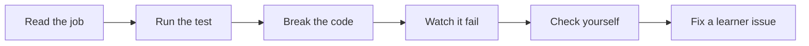

# Labs for project 1 of the Agentic AI Buildcamp

Each lab is one property of the platform. Its README says the job it does for Quillon's medical
information service, and a test proves it. Each README ends with a change that breaks the property. You
watch the test fail before you trust it.

Read [the architecture walkthrough](../docs/architecture-walkthrough.md) first for how the parts fit together.



Every lab page has the same parts:

- **What you will learn:** the skills you leave with.
- **How it works:** one diagram of the flow.
- **See it in the console:** the screen the property shows up on. The Screen column names it. A lab marked
  Terminal only shows its result in the test output.
- **Break it, watch the test fail:** one change that turns the test red.
- **Check yourself:** questions with folded answers.
- **Try next:** open learner issues that grow the same property.

```bash
make up                # Floci, for the labs that touch AWS
make lab N=<folder>    # one lab
uv run pytest -q labs  # every lab, and make check runs them too
```

Expect: `make lab N=route-inquiries-with-a-routing-table` ends with `5 passed`.

The Screen column names a shot in `docs/product-walkthrough-shots/`. `tests/test_labs_steps.py` checks
that each lab page shows the shot this table names.

| Lab | The property | Screen | Needs Floci |
|---|---|---|---|
| [Route inquiries with a routing table](route-inquiries-with-a-routing-table/) | The order of the rules is the policy; the model never routes | `routing-table` | No |
| [Ground replies with approved blocks](ground-replies-with-approved-blocks/) | Every sentence is traced to a current approved block | `case-sent` | No |
| [Guard tool calls with Cedar](guard-tool-calls-with-cedar/) | An agent reads only its own case's country and product | `case-guards` | Yes |
| [Prove the audit trail with a hash chain](prove-the-audit-trail-with-a-hash-chain/) | An edit to any past entry is found; the archive cannot be deleted | `ledger-tamper` | Partly |
| [Gate releases with evals](gate-releases-with-evals/) | One missed adverse event fails the release | `release-gate` | No |
| [Pin the model with Agent SDK options](pin-the-model-with-agent-sdk-options/) | An allowlist of two models, nothing loaded from the machine, a bill we compute | Terminal only | No |
| [Pick the model with a router](pick-the-model-with-a-router/) | Haiku by default, Sonnet when asked, then a person | `agents` | No |
| [Bound agent plans with a policy kernel](bound-agent-plans-with-a-policy-kernel/) | A plan cannot skip a step, rewrite a fact or loop forever | Terminal only | No |
| [Arbitrate agents with a supervisor](arbitrate-agents-with-a-supervisor/) | Policy settles two touches to one doctor, not a model | `hcp-360` | No |
| [Keep a case alive with Temporal](keep-a-case-alive-with-temporal/) | An overdue review is escalated once and a late decision still lands | `review-bench` | Yes, and Temporal |
| [Isolate tenants with row level security](isolate-tenants-with-row-level-security/) | The database, not the code, refuses another tenant's rows | Terminal only | Yes |
| [Retrieve behind a facet gate](retrieve-behind-a-facet-gate/) | Withdrawn, expired and foreign content is never a candidate | `withdraw-content` | Yes |
| [Let the guardian only tighten](let-the-guardian-only-tighten/) | Reviewers' rejections can switch a country off, never on | `kill-switch` | Yes |
| [Watch with the sentinel and steward](watch-with-the-sentinel-and-steward/) | Safety signals and draft invalidation happen with nobody asking | `case-adverse-event` | Yes, and Temporal |
| [Delegate with a narrow brief](delegate-with-a-narrow-brief/) | A helper sees only the question's context and the lead checks its answer | Terminal only | No |
| [Fit the thread to a token budget](fit-the-thread-to-a-token-budget/) | Old turns are dropped first and the question always stays | Terminal only | No |
| [Cap model calls per case and day](cap-model-calls-per-case-and-day/) | A case and a tenant stop at a hard call limit | Terminal only | No |
| [Redraft a failed check once](redraft-a-failed-check-once/) | A failed grounding check gets one redraft, then a person | `case-review` | No |
| [Tokenise PHI with a vault](tokenise-phi-with-a-vault/) | The model sees tokens and the reply is restored from a sealed per-case vault | Terminal only | No |
| [Pin MCP tools with description hashes](pin-mcp-tools-with-description-hashes/) | A tool whose description changed is not served | Terminal only | No |
| [Keep safety intake moving with a manual queue](keep-safety-intake-moving-with-a-manual-queue/) | A failed detector hands notes to a person and drops none | Terminal only | No |
| [Split data into zones](split-data-into-zones/) | Marketing sees that contact is on hold, never the medical case behind it | `field-rep-denied` | Yes |
| [Bind the signature to the reply](bind-the-signature-to-the-reply/) | A reply changed after signing is never sent, and a withdrawal closes the draft | `approve-blocked` | Yes |
