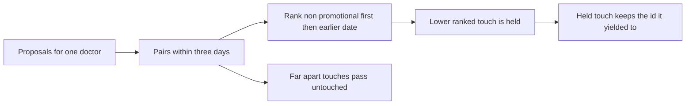
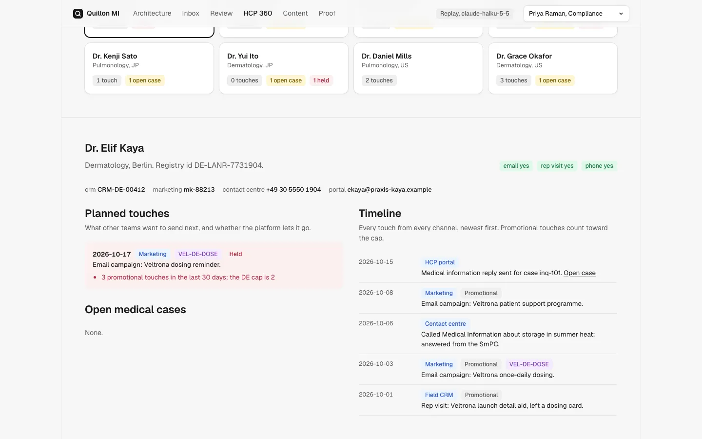

# Arbitrate agents with a supervisor

**The job:** marketing plans an email, a rep plans a visit and the inquiry agent has a reply ready. All three are for the same doctor in the same week. Someone has to decide which goes, and Compliance has to read why.

**Before:** each team sends on its own schedule, or one agent asks another in free text and nobody can
replay the conversation.

**After:** proposals are rows. Two may fall within three days of each other. Then the supervisor applies one
rule: a touch that answers the doctor's own need beats a promotional one, then the earlier date wins. The
loser is held, not deleted, and keeps the id of the proposal it yielded to. No model is asked.

## What you will learn

- Explain how plain rules settle two touches to one doctor.
- Prove that the result does not depend on arrival order.

## Prerequisites

[uv](https://docs.astral.sh/uv/) only. No Floci or API key is needed.

## How it works



## Steps

1. Go through the plans from the best to the worst.
2. Find a better plan that clashes and has not lost itself.
3. If there is one, this plan gives way to it.

These are the `# Step` comments in `arbitrate`.

## Run it

```bash
make lab N=arbitrate-agents-with-a-supervisor
```

Expect: 4 passed

## See it in the console



HCP 360. A planned campaign email is held because the doctor hit the contact cap.

## Read

- `src/hcpagents/supervisor.py`: `arbitrate`.
- `docs/adr/0023-the-coordinator-holds-and-the-supervisor-settles.md` and `docs/adr/0032-agents-talk-through-state-and-events-not-to-each-other.md`.

## What the test proves

- A reply to the doctor beats a campaign, whichever was planned first.
- Between equals the earlier date wins, and far-apart touches do not conflict at all.
- The result does not depend on the order proposals arrive in.

## Break it, watch the test fail

In `src/hcpagents/supervisor.py`, change `bool(p.get("promotional"))` to `False` in `_rank`. The first
test fails: a campaign planned earlier would now silence a doctor's own question. Put it back.

## What production adds

The outreach coordinator feeds the supervisor from the HCP 360 record. An open medical case blocks
promotion outright, and every held touch carries its rule and source interactions on the ledger.

## Check yourself

<details>
<summary>A reply to the doctor and a campaign email clash. Which one wins?</summary>

The reply. It beats a campaign, whichever was planned first.

</details>

<details>
<summary>Why is this a rule and not a model choice?</summary>

Compliance can read a rule and a test can walk it. A model may decide differently next time.

</details>

## Try next

Pick a learner issue. Write the test that fails first, then fix it.

- [#23 Prove duplicate touches are held across teams](https://github.com/learnwithparam/enterprise-agentic-architecture/issues/23)
- [Every open learner issue](https://github.com/learnwithparam/enterprise-agentic-architecture/issues?q=is%3Aopen+label%3Aassignment)

## New words

- **supervisor**: The code that picks which of two clashing proposals goes first.
- **proposal**: A planned touch to a doctor, saved as a row.
- **promotional**: A touch that sells, not one that answers a doctor's own question.
- **held**: Put on hold, not deleted.
