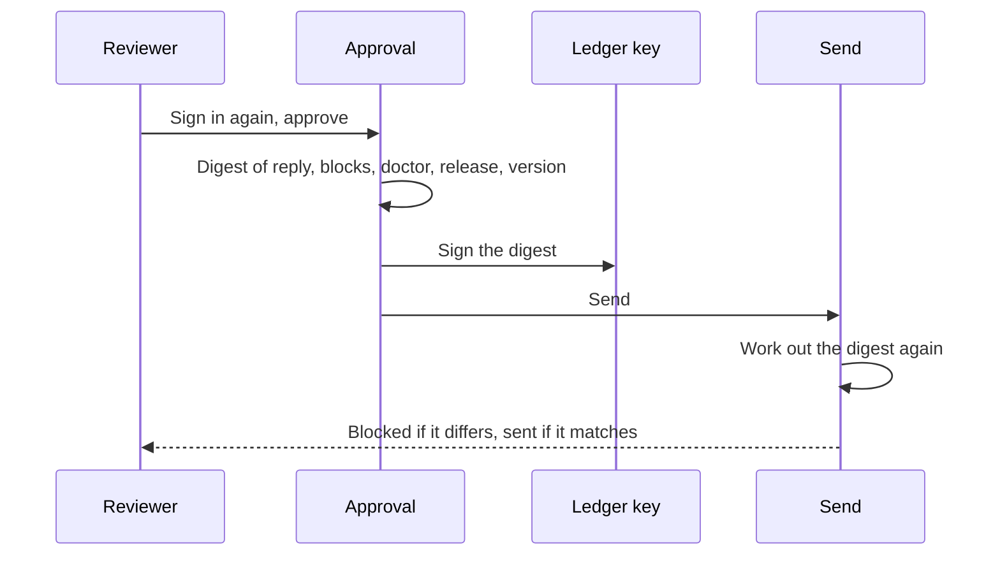
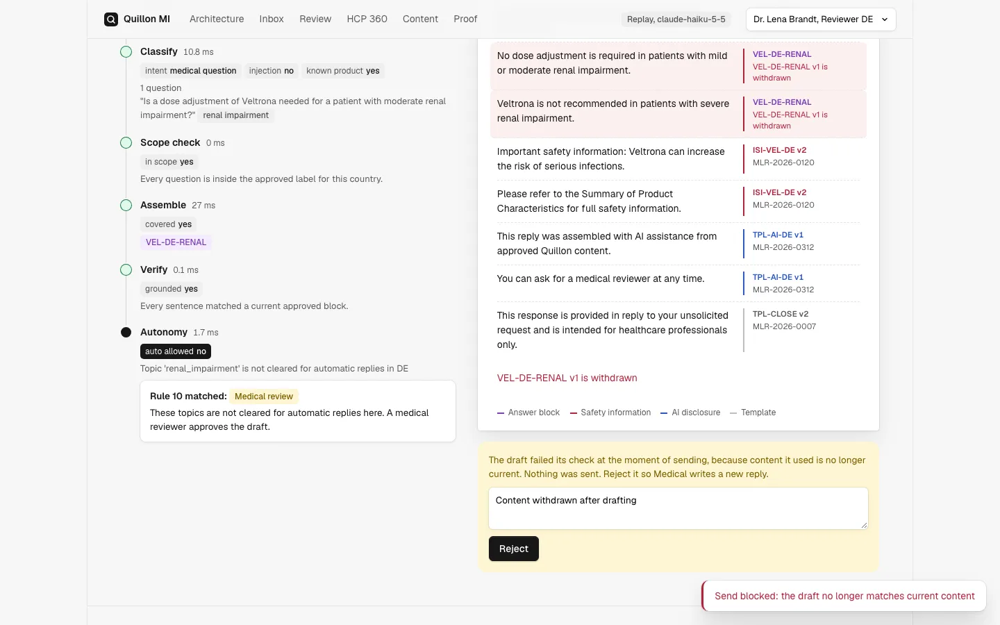

# Bind the signature to the reply

**The job:** a reviewer at Quillon approves a reply to a German doctor. Between the click and the send, the
text must not change, and the content it uses must not be pulled.

**Before:** the signature said only "this person approved". The send checked the sentences again, but nothing
tied the approval to the reply the reviewer saw. A reviewer could also spend time on a draft whose source had
been withdrawn an hour ago.

**After:** the signature covers a digest of the exact reply. The digest holds the text, each block and its version, the doctor,
the country, the release and the draft version. The ledger key signs the digest. The send works the digest out
again and stops if anything moved. A withdrawal closes every draft that uses the block at once, so nobody can
sign it.

## What you will learn

- Explain what a signature binds a reviewer to.
- Prove that a reply changed after signing is never sent.

## Prerequisites

Docker, [uv](https://docs.astral.sh/uv/) and `make up`. No API key.

## How it works



## Run it

```bash
make up
make lab N=bind-the-signature-to-the-reply
```

Expect: `4 passed`

## See it in the console



Approval blocked at send. The reply changed after it was signed.

## Read

- `src/hcpagents/approval.py`: the digest, `bind` and `problems`.
- `src/hcpagents/case_review.py`: `approve` and the withdrawal steps.
- `src/hcpagents/case_send.py`: the check before the send, and the draft sources note.

## What the test proves

- An approval keeps the digest, the release and the draft version from the moment of signing.
- A reply changed after signing is never sent.
- A signature that the key does not recognise is refused.
- A withdrawal closes the draft before a reviewer can sign it.

## Break it, watch the test fail

In `src/hcpagents/case_send.py`, change `unsigned = approval.problems(doc)` to `unsigned = []`. The second
test fails: the changed reply goes out. Put it back.

## What production adds

A time stamp from an outside authority, and a long-term store for the signed records. The key here is the
ledger key, one for the whole system.

## Check yourself

<details>
<summary>A reply is edited after the reviewer signed it. Is it sent?</summary>

No. The signature covers the exact text, so the changed reply is refused.

</details>

<details>
<summary>A block is withdrawn before the reviewer signs. What happens to the draft?</summary>

It is closed, so it cannot be signed.

</details>

## Try next

Pick a learner issue. Write the test that fails first, then fix it.

- [#24 Keep a version history for content blocks](https://github.com/learnwithparam/enterprise-agentic-architecture/issues/24)
- [Every open learner issue](https://github.com/learnwithparam/enterprise-agentic-architecture/issues?q=is%3Aopen+label%3Aassignment)

## New words

- **digest**: A short fingerprint of some data. Change one letter and it changes.
- **e-signature**: A person's own sign-in, kept with what it meant and when it happened.
