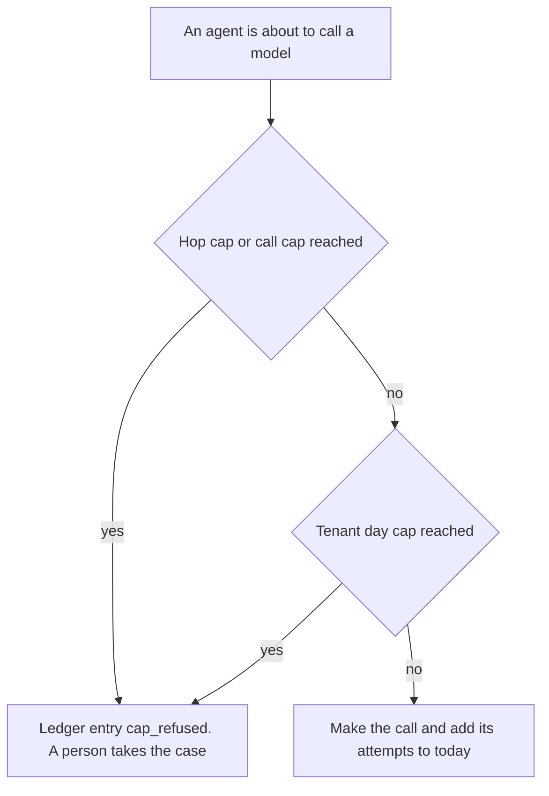

# Cap model calls per case and per day

**The job:** two agents that keep handing work to each other, or one case that keeps retrying, can spend a
tenant's money while nobody watches. The cost per case is already capped. This lab caps the count of calls
too, and the count of calls a tenant makes in a day.

**Before:** the only brake is money, and it is checked in one process. A restart forgets it.

**After:** a case may run at most six agent runs and twelve model calls, retries included. A tenant may make
at most 5000 calls a day. The case counts come from the saved case. The day count is a document in the
tenant's own store, so a new worker sees the same numbers.

Past a cap, no call is made. The ledger gets an
entry named `cap_refused` with the reason, and the case goes to a person with the rule `cap_exceeded`.

## What you will learn

- Explain the three caps on model calls.
- Prove that each cap refuses on its own and names itself.

## Prerequisites

[uv](https://docs.astral.sh/uv/) only. No Floci or API key is needed.

## How it works



## Steps

1. The hops and the calls of this one case.
2. The tenant's calls today, read from the store so a restart cannot hide them.

These are the `# Step` comments in `check`.

## Run it

```bash
make lab N=cap-model-calls-per-case-and-day
```

Expect: 5 passed

## Read

- `src/hcpagents/agent_caps.py`: the three caps: `check`, `reserve` and `settle`.
- `src/hcpagents/case_core.py`: `refuse_over_cap`, which runs before every model call.

## What the test proves

- A case under every cap may call.
- The hop cap, the call cap and the day cap each refuse on their own and name themselves.
- A retry on Sonnet counts as a call.

## Break it, watch the test fail

In `src/hcpagents/agent_caps.py`, change `if calls_today() >= day_cap:` to `if False:`. The day cap test
fails: a tenant could spend with no daily limit. Put it back.

## What production adds

`tests/test_live_g_caps.py` runs a real case. It shows the model is never called after a refusal and that the
kernel turns the refusal into a review with the rule `cap_exceeded`.

## Check yourself

<details>
<summary>Does a retry on Sonnet count against the cap?</summary>

Yes. It counts as a call.

</details>

<details>
<summary>What happens with no day cap?</summary>

A tenant could spend with no daily limit.

</details>

## Try next

Pick a learner issue. Write the test that fails first, then fix it.

- [Every open learner issue](https://github.com/learnwithparam/enterprise-agentic-architecture/issues?q=is%3Aopen+label%3Aassignment)

## New words

- **cap**: A hard limit on how many times something may happen.
- **hop**: One agent run inside a case.
- **ledger**: The saved record of what the system did.
- **tenant**: One client company whose data is kept apart from the others.
