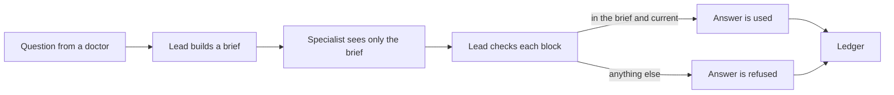

# Delegate with a narrow brief

**The job:** a lead agent for Quillon's medical information service gets a doctor's question about storing
Veltrona. It hands that one sub-question to a specialist step. The specialist must never see the doctor's
contacts, consent or other cases, and the lead must never use an answer it has not checked.

**Before:** the whole case goes to every helper, so a helper can leak a doctor's private notes. The lead trusts whatever comes back, even a block from another country.

**After:** the lead builds a brief for this question only: the facts of one country and the current blocks of
one product. The specialist gets a copy of the brief. The lead then accepts an answer only if each block is
in the brief and still current. Every outcome goes on the ledger.

## What you will learn

- Explain what a narrow brief hides from a helper.
- Prove that a helper cannot widen its own context.

## Prerequisites

[uv](https://docs.astral.sh/uv/) only. No Floci or API key is needed.

## How it works



## Steps

1. The brief holds one country and one product, and no doctor.
2. The specialist gets a copy of the brief and nothing else.
3. The lead refuses a block that is not in the brief or not current.
4. Write the outcome to the ledger.
5. A bad answer gives no block.

These are the `# Step` comments in `delegate`.

## Run it

```bash
make lab N=delegate-with-a-narrow-brief
```

Expect: 4 passed

## Read

- `src/hcpagents/context.py`: `for_question`.
- `src/hcpagents/delegation.py`: `specialist`, `check` and `delegate`.
- `docs/adr/0032-agents-talk-through-state-and-events-not-to-each-other.md`.

## What the test proves

- The brief for a German storage question holds one block, and no United States or Ombrexa block.
- The specialist step never sees the doctor's name, email, registry id, consent or the case id.
- A block outside the brief is refused, so a helper cannot widen its own context.
- A block withdrawn after the brief was built is refused at the check.

## Break it, watch the test fail

In `src/hcpagents/delegation.py`, change `if block_id not in allowed:` to `if False:`. Step 3 fails: the
lead would use a United States block for a German doctor. Put it back.

## What production adds

`outreach.ask_for_content` is the lead's entry point. It reads the content store as it is now. The ledger entry names the case, the blocks and every problem, so Compliance can replay the delegation.

## Check yourself

<details>
<summary>A helper tries to use a block that is not in its brief. What happens?</summary>

The lead refuses it at the check.

</details>

<details>
<summary>Does the helper see the doctor's name?</summary>

No. It never sees the name, email, registry id, consent or case id.

</details>

## Try next

Pick a learner issue. Write the test that fails first, then fix it.

- [Every open learner issue](https://github.com/learnwithparam/enterprise-agentic-architecture/issues?q=is%3Aopen+label%3Aassignment)

## New words

- **brief**: The small set of facts handed to a helper for one question.
- **specialist**: A helper step that answers one sub-question.
- **block**: A piece of approved text that a reply may quote.
- **ledger**: The saved record of what the system did.
