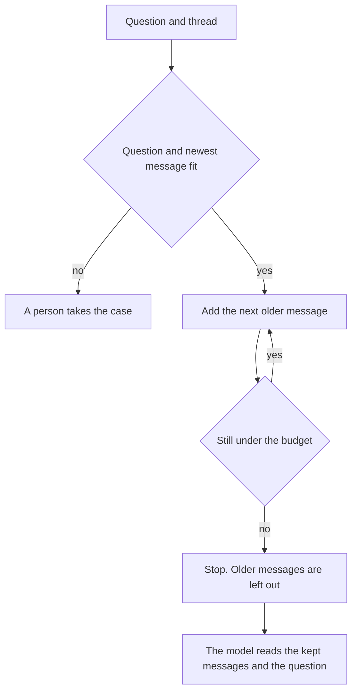

# Fit the thread to a token budget

**The job:** a doctor writes back in the same thread for weeks. Quillon's agents read the question and the
messages before it. A model reads only so much, and every token costs money. The thread must fit a budget,
and it must never lose the question or the latest message.

**Before:** the whole thread goes to the model. A long thread is slow, costs more and can push the question
out of the window.

**After:** the case counts tokens for every model call. It keeps the question and the newest message, then
adds older messages from the newest back while they fit. The oldest go first. Nothing is summarised by a
model, so nothing is invented. The ledger says how many messages were left out, and the full thread stays in the case.

The plain safety rules still read the whole thread, so a side effect in an old message is found.

## What you will learn

- Explain which turns go first when a thread is too long.
- Prove that the question is never cut.

## Prerequisites

[uv](https://docs.astral.sh/uv/) only. No Floci or API key is needed.

## How it works



## Steps

1. The question and the newest message must stay.
2. Walk back from the newest message and stop at the first one that does not fit.

These are the `# Step` comments in `fit_thread`.

## Run it

```bash
make lab N=fit-the-thread-to-a-token-budget
```

Expect: 5 passed

## Read

- `src/hcpagents/agent_context.py`: `count_tokens`, `fit_thread` and `model_text`.
- `src/hcpagents/case_core.py`: `thread_text` and the `input_tokens_est` on every model call.

## What the test proves

- Old turns are dropped first, and the newest turn stays.
- A thread that fits is kept whole, and an inquiry with no thread is sent word for word.
- A question that cannot fit goes to a person. It is not cut.

## Break it, watch the test fail

In `src/hcpagents/agent_context.py`, change `for turn in reversed(thread[:-1]):` to
`for turn in thread[:-1]:`. The first test fails: the oldest turns would be kept and the newest dropped.
Put it back.

## What production adds

`tests/test_live_g_context.py` runs a real case. It checks the model prompt stays under the budget and that
the ledger entry `context_trimmed` names how many messages were dropped.

## Check yourself

<details>
<summary>A thread is too long. Which turns are dropped?</summary>

The oldest turns. The newest turn stays.

</details>

<details>
<summary>The question alone does not fit. What happens?</summary>

It goes to a person. It is not cut.

</details>

## Try next

Pick a learner issue. Write the test that fails first, then fix it.

- [Every open learner issue](https://github.com/learnwithparam/enterprise-agentic-architecture/issues?q=is%3Aopen+label%3Aassignment)

## New words

- **token**: A small piece of text that a model counts and charges for.
- **token budget**: The most tokens one model call may use.
- **thread**: The chain of messages in one case.
- **context window**: The amount of text a model can read at once.
