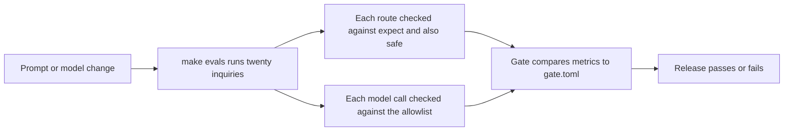

# Gate releases with evals

**The job:** an engineer changes the triage prompt to handle Japanese better. Before that change reaches a
doctor, the team must know it still sends every adverse event to pharmacovigilance, never sends a reply a
human should have reviewed, and never calls a model outside the allowlist in `evals/gate.toml`: Haiku 5.5
by default, Sonnet 5.5 where the router allows it.

**Before:** someone tries a few questions in a playground and says it looks fine.

**After:** `evals/gate.toml` is the release contract. `make evals` runs all twenty synthetic inquiries
through the full graph and scores them; `make check` fails on any line that does not hold. Each inquiry
lists its expected route and the more cautious routes that are also safe, so caution passes and risk does
not.

## Prerequisites

[uv](https://docs.astral.sh/uv/) only. No Floci or API key is needed.

## How it works



## Run it

```bash
make lab N=gate-releases-with-evals   # the gate's logic, no Floci needed
make up && make evals                 # the real gate over every inquiry, in replay, free
```

Expect: 5 passed

Then `make evals` scores all twenty inquiries; its last two lines are the totals and the verdict.

Expect: 20 cases, route_acceptable 1.0, ae_recall 1.0, then `gate passed`

## Read

- `evals/gate.toml` for the thresholds.
- `src/hcpagents/evals.py`: `score` and `gate`.
- `world/inquiries.toml` for each inquiry's `expect`, `also_safe` and `why`.
- The Release gate section of `/proof` in the console.

## What the test proves

- A run where every case lands on its expected route passes.
- One adverse event routed to a reviewer instead of pharmacovigilance fails the release on recall.
- A more cautious route listed as also safe passes; sending what a human should review fails.
- One call on a model outside the allowlist fails the release.

## Break it, watch the test fail

In `evals/gate.toml`, set `ae_recall = 0.0` and rerun the lab. The missed adverse event test fails: the gate
would now ship a change that drops safety reports. Put it back to `1.0`.

## What production adds

The same gate in CI on every pull request that touches a prompt, a model id, content or a policy, with
`LIVE=1` against Bedrock on a schedule so drift in the model shows up even when the code has not changed.
Per-call traces go to Langfuse for review.
