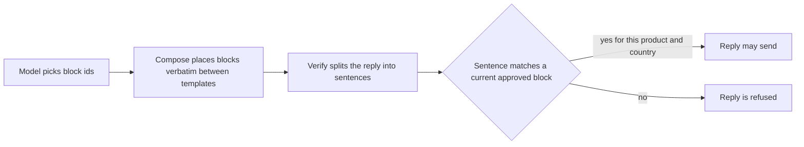

# Ground replies with approved blocks

**The job:** a German dermatologist asks how to dose Veltrona. The reply must say only what Medical, Legal
and Regulatory approved for Germany. It must use the version that is approved today. An auditor must be
able to point at any sentence and find its approval number.

**Before:** the model writes the reply from retrieved passages. It reads well. Nobody can prove that the
sentence about food was in the approved text and not written by the model.

**After:** the model picks block ids. `grounding.compose` places those blocks word for word between fixed
templates, the safety information and the AI disclosure. `grounding.verify` splits the result into
sentences. Each one must match a sentence in a current approved block for that product and country. A
changed word fails the check. So does a withdrawn block or another country's label.

## Prerequisites

[uv](https://docs.astral.sh/uv/) only. No Floci or API key is needed.

## How it works



## Run it

```bash
make lab N=ground-replies-with-approved-blocks
```

Expect: 4 passed

## Read

- `src/hcpagents/grounding.py`: `compose`, `verify` and `required_ids`.
- `world/content.toml` for the synthetic blocks, each with a version, MLR reference and validity dates.
- `docs/adr/0002-model-selects-ids-never-writes.md`.

## What the test proves

- Every sentence of a composed reply carries its block id, version and MLR reference.
- A paraphrase is not evidence, even when it adds one harmless phrase.
- A block withdrawn after the draft was written leaves its sentences untraced, which is why the same check
  runs again at the moment of sending (`cases._send`).
- Another country's label is not evidence for this country's reply.

## Break it, watch the test fail

In `src/hcpagents/grounding.py`, replace `live = [b for b in sources if is_current(b, today)]` with
`live = sources` and rerun the lab. The withdrawn block test fails: a sentence from withdrawn content now
counts as traced. Put the line back. `scripts/mutate.py` makes this same change on every `make check`.

## What production adds

The block store is the client's content management system. An adapter reads it and keeps the block id,
version and approval reference. The check is the same code.

## New words

- **grounding**: Making sure every sentence of a reply comes from approved text.
- **block**: A piece of approved text with an id and a version.
- **verbatim**: Word for word, with no change.
- **MLR**: The Medical, Legal and Regulatory review that approves content.
