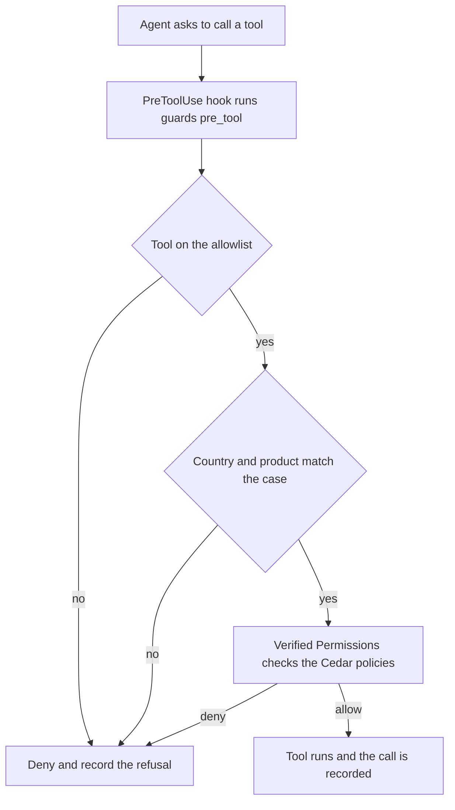

# Guard tool calls with Cedar

**The job:** the assembler agent searches approved content for a German Veltrona case. It must never read
US or Japanese content for that case. It must never call a tool that is not on its list. Every call it
makes must be on the audit trail with the reason, whether the call was allowed or refused.

**Before:** the agent has a search tool and a prompt that says "only use German content". A prompt is a
request, not a control.

**After:** an Agent SDK `PreToolUse` hook runs `guards.pre_tool` before every call. The guard checks the
allowlist and the case's country and product in code. Then it asks Amazon Verified Permissions. There,
`policies/cedar/agents.cedar` says the same thing in a language Compliance can read. Either check alone can
refuse.

## Prerequisites

Docker, [uv](https://docs.astral.sh/uv/) and `make up` (Floci and the policy store).

## How it works



## Steps

1. Refuse a tool that is not on the allowlist.
2. Find the country and product the call is about.
3. Refuse a call for another country or product.
4. Ask Cedar if this agent may call this tool.

These are the `# Step` comments in `pre_tool`.

## Run it

```bash
make up    # Floci and the policy store
make lab N=guard-tool-calls-with-cedar
```

Expect: 3 passed

## Read

- `src/hcpagents/guards.py` and `src/hcpagents/authz.py`.
- `policies/cedar/agents.cedar`.
- The `pre` hook inside `agents._options` in `src/hcpagents/agents.py`, which turns a refusal into
  `permissionDecision: deny` for the SDK.

## What the test proves

- The case's own country and product pass both checks, and the reason names the policy file.
- Verified Permissions refuses another country on its own, so a bug in the code guard is not enough.
- A tool off the allowlist is refused before the policy store is even asked.

## Break it, watch the test fail

In `policies/cedar/agents.cedar`, replace the `when { ... }` block with `when { principal.kind == "agent" };`
and rerun the lab. The store is keyed on a hash of the Cedar files, so the edited policy is the one in
force, and the "another country" test fails. Put the block back.

## What production adds

The same policy store and the same `is_authorized` call are used. The entities come from the identity
provider's claims. Each decision lands on the ledger with the policy file that made it.

## New words

- **Cedar**: A readable language for writing permission rules.
- **PreToolUse hook**: Code that runs before an agent calls a tool and may refuse the call.
- **allowlist**: The short list of tools an agent may use.
- **Verified Permissions**: The AWS service that checks Cedar rules.
