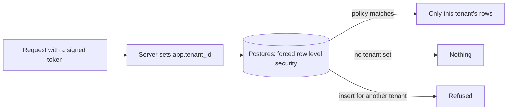

# Isolate tenants with row level security

**The job:** a second pharmaceutical company joins the platform. Its content, cases and ledger must be
invisible to the first, even if one query forgets a `WHERE tenant_id = ...`.

**Before:** isolation is a filter every query has to remember. One missing filter shows a client another
client's medical content.

**After:** Postgres enforces it. Every table forces row level security with a policy on `app.tenant_id`, and
the app role has no way around it (ADR 0009 and 0011).

## Prerequisites

Docker, [uv](https://docs.astral.sh/uv/) and `make up`. No API key.

## How it works



## Run it

```bash
make up
make lab N=isolate-tenants-with-row-level-security
```

Expect: `4 passed`

## Read

- `migrations/001_documents.sql`: `ENABLE`, `FORCE` and the `tenant_isolation` policy.
- `src/hcpagents/db.py`: `as_tenant` and `session`.
- `tests/test_tenancy.py`, which also walks every table in the schema.

## What the test proves

- With no tenant set, the app role sees no rows.
- The app role cannot write a row for another tenant.
- A second tenant starts with an empty world while the first tenant's rows stay untouched.
- The migration itself declares `FORCE` and a policy that checks the tenant on read and write.

## Break it, watch the test fail

In `migrations/001_documents.sql`, change the `docs` policy to `USING (true)` and rerun the lab. The
migration test fails: the policy no longer checks the tenant, and a fresh database would show every tenant to
every other. Put it back.

## What production adds

One more policy per new table, checked by the schema walk in `tests/test_tenancy.py`, and a migration that
cannot land without it.
