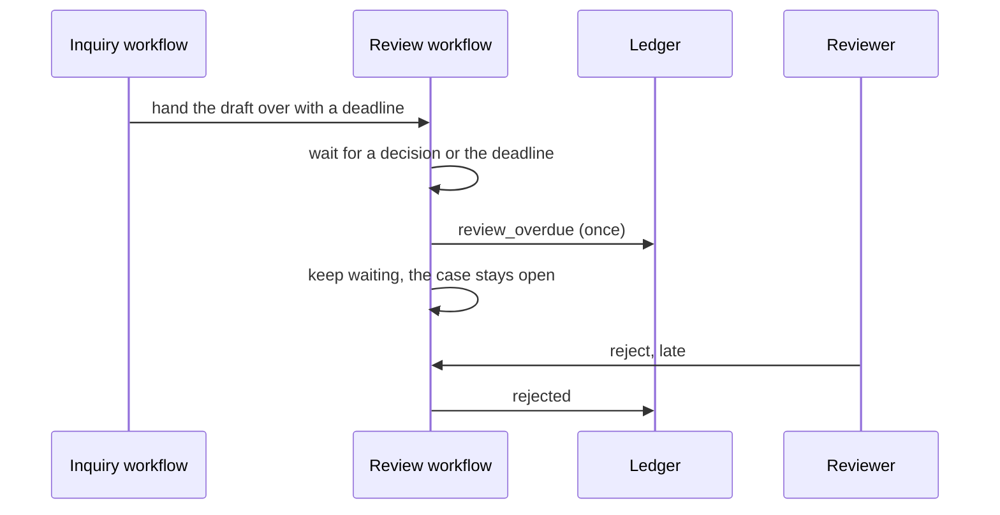

# Keep a case alive with Temporal

**The job:** a draft waits for a German reviewer, and the reviewer is on leave. Medical information must
find out within the deadline, and the case must still be there when the reviewer comes back.

**Before:** the wait lives in a process. A deploy or a crash forgets who was waiting, and nobody is told
the draft is overdue.

**After:** the wait is a Temporal workflow with a deadline. When the deadline passes it escalates once,
writes `review_overdue` to the ledger, and keeps waiting. A late decision still lands (ADR 0016 and 0017).

## Prerequisites

Docker, [uv](https://docs.astral.sh/uv/) and `make up` (Postgres, Floci and Temporal). No API key: model
calls replay from `recordings/`.

## How it works



## Run it

```bash
make up
make lab N=keep-a-case-alive-with-temporal
```

Expect: `2 passed`

## Read

- `src/hcpagents/workflows.py`: `ReviewWorkflow.run` and `InquiryWorkflow`.
- `src/hcpagents/activities.py`: `escalate_case`.
- `docs/adr/0016-temporal-owns-the-life-of-a-case.md` and `docs/adr/0017-a-reviewer-wait-is-a-workflow-with-a-deadline-and-a-signature.md`.

## What the test proves

- A review nobody decides is escalated exactly once, one second after a one second deadline.
- Escalation does not close the case: a decision a second later still lands, and the case records when it was escalated.

## Break it, watch the test fail

In `src/hcpagents/workflows.py`, delete the `await workflow.execute_activity("escalate_case", ...)` call.
The first test fails: no `review_overdue` ever reaches the ledger, so nobody learns the draft is stuck. Put it back.

## What production adds

A worker per tenant queue, and a deadline in days, not seconds. Temporal keeps the wait across deploys.
