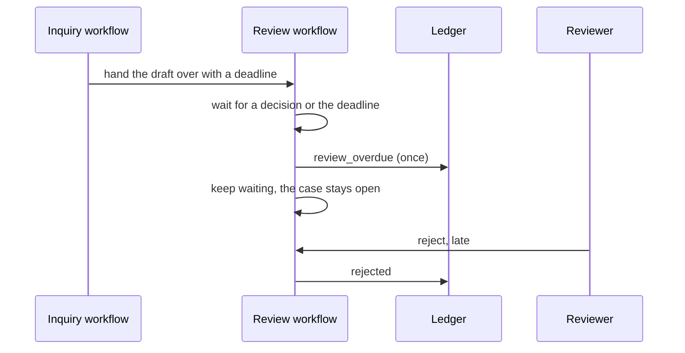
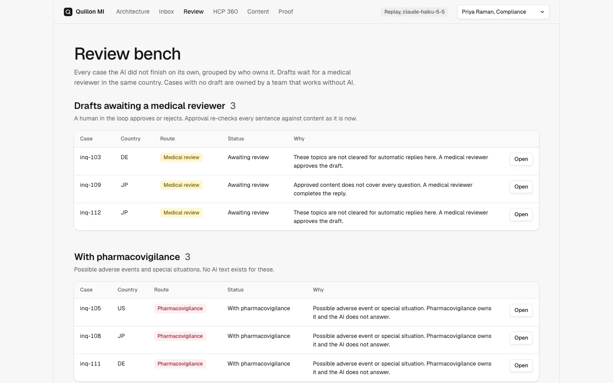

# Keep a case alive with Temporal

**The job:** a draft waits for a German reviewer, and the reviewer is on leave. Medical information must
find out within the deadline, and the case must still be there when the reviewer comes back.

**Before:** the wait lives in a process. A deploy or a crash forgets who was waiting, and nobody is told
the draft is overdue.

**After:** the wait is a Temporal workflow with a deadline. When the deadline passes it escalates once,
writes `review_overdue` to the ledger, and keeps waiting. A late decision still lands (ADR 0016 and 0017).

## What you will learn

- Run a durable case that waits for a human.
- Prove that an overdue review is escalated once and a late decision still lands.

## Prerequisites

Docker, [uv](https://docs.astral.sh/uv/) and `make up` (Postgres, Floci and Temporal). No API key: model
calls replay from `recordings/`.

## How it works



## Steps

1. Take the deadline from the caller, or use the default.
2. Wait for a person to close the case until the deadline.
3. At the deadline, escalate the case and keep waiting.

These are the `# Step` comments in `run`.

## Run it

```bash
make up
make lab N=keep-a-case-alive-with-temporal
```

Expect: `2 passed`

## See it in the console



The review bench. Drafts wait here for a medical reviewer in the same country.

## Read

- `src/hcpagents/workflows.py`: `ReviewWorkflow.run` and `InquiryWorkflow`.
- `src/hcpagents/activities.py`: `escalate_case`.
- `docs/adr/0016-temporal-owns-the-life-of-a-case.md` and `docs/adr/0017-a-reviewer-wait-is-a-workflow-with-a-deadline-and-a-signature.md`.

## What the test proves

- A review nobody decides is escalated exactly once, one second after a one second deadline.
- Escalation does not close the case: a decision a second later still lands, and the case records when it was escalated.

## Break it, watch the test fail

In `src/hcpagents/workflows.py`, delete the `await workflow.execute_activity("escalate_case", ...)` call.
The first test fails: no `review_overdue` ever reaches the ledger, so nobody learns the draft is stuck. Put it back.

## What production adds

A worker per tenant queue, and a deadline in days, not seconds. Temporal keeps the wait across deploys.

## Check yourself

<details>
<summary>Nobody decides a review in time. How many times is it escalated?</summary>

Exactly once.

</details>

<details>
<summary>Does escalation close the case?</summary>

No. A decision that comes later still lands, and the case records when it was escalated.

</details>

## Try next

Pick a learner issue. Write the test that fails first, then fix it.

- [#21 Test the answer-in-minutes goal](https://github.com/learnwithparam/enterprise-agentic-architecture/issues/21)
- [#28 Feed failed events into the dead letter queue](https://github.com/learnwithparam/enterprise-agentic-architecture/issues/28)
- [Every open learner issue](https://github.com/learnwithparam/enterprise-agentic-architecture/issues?q=is%3Aopen+label%3Aassignment)

## New words

- **Temporal**: A tool that keeps a long task alive across crashes and deploys.
- **workflow**: A task that Temporal runs and remembers.
- **escalate**: Tell someone that a task is overdue.
- **signal**: A message sent to a running workflow.
