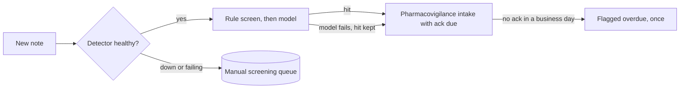

# Keep safety intake moving with a manual queue

**The job:** a rep's note says "patient developed a rash". At that moment the safety detector fails. A
failed detector must not turn an adverse event into a normal review item. No note may be dropped.

**Before:** a failing safety model threw away the rule hits. The case went to review, not to
pharmacovigilance. A detector that stopped quietly dropped notes.

**After:** the rule hits are saved before any model runs. A model failure keeps them, and the case still
goes to pharmacovigilance. If the detector fails, or is silent for two hours, a person screens each note
from a manual queue. Each safety intake has one business day to be acknowledged. A late one is flagged once.

## Prerequisites

[uv](https://docs.astral.sh/uv/). No Docker, no API key. The lab test fakes the store and the ledger in memory.

## How it works



## Run it

```bash
make lab N=keep-safety-intake-moving-with-a-manual-queue
```

Expect: `3 passed`

## Read

- `src/hcpagents/safety_clock.py`: the two clocks and the manual queue.
- `src/hcpagents/case_core.py`: `safety_screen` saves the rule hits first.
- `src/hcpagents/sentinel.py`: `_screen` sends a note to a person when the detector is down.

## What the test proves

- A note read while the detector is down lands in the manual queue and is not dropped.
- An acknowledgment is due one business day later, so a Friday signal is due on Monday.
- An overdue intake is put on the ledger once and an acknowledged intake never is.

## Break it, watch the test fail

In `src/hcpagents/safety_clock.py`, change `OUTAGE_LIMIT = timedelta(hours=2)` to `timedelta(hours=200)`.
The first test fails: a detector silent for three hours is still treated as healthy. Put it back.

## What production adds

A real business calendar with public holidays for each country, a page for the person on call, and an alarm
on the age of the oldest item in the manual queue.

## New words

- **acknowledgment**: The safety team confirming it has the signal.
- **heartbeat**: A small record the detector writes after each healthy pass.
- **manual queue**: A list a person works through when the detector cannot.
