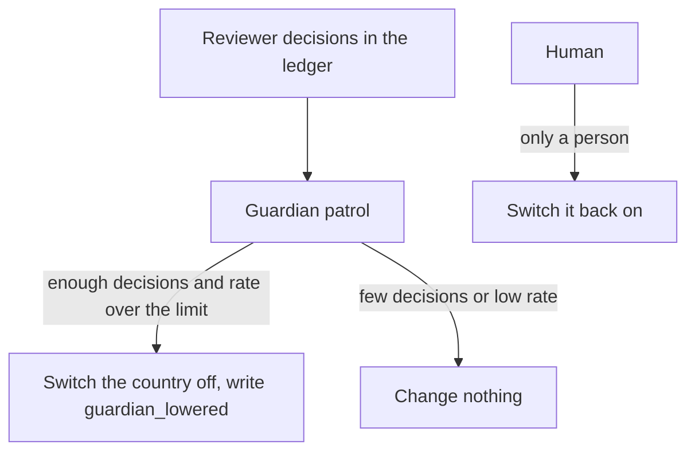

# Let the guardian only tighten

**The job:** reviewers in Germany reject most automatic drafts this week. The platform must stop sending
automatically there without waiting for a meeting, and it must never loosen anything by itself.

**Before:** a person notices the rejections, if anyone looks, and edits a setting.

**After:** a guardian reads the reviewers' decisions and can only switch a country off. Switching it back on
is a human act, and an improver can only write proposals (ADR 0026).

## Prerequisites

Docker, [uv](https://docs.astral.sh/uv/) and `make up`. No API key.

## How it works



## Run it

```bash
make up
make lab N=let-the-guardian-only-tighten
```

Expect: `3 passed`

## Read

- `src/hcpagents/guardian.py`: `override_rates` and `patrol`.
- `src/hcpagents/improver.py`: proposals only.
- `docs/adr/0026-the-guardian-only-tightens-and-the-improver-only-proposes.md`.

## What the test proves

- Reviewers who reject too much switch one country off, and no other country.
- A spotless record never switches a country back on.
- Too few decisions change nothing.

## Break it, watch the test fail

In `src/hcpagents/guardian.py`, change `s | {"enabled": False}` to `s | {"enabled": True}`. The first test
fails: the guardian now loosens the country it was meant to tighten. Put it back.

## What production adds

A guardian per tenant and a window that starts at the last human change, so old rejections stop counting.
