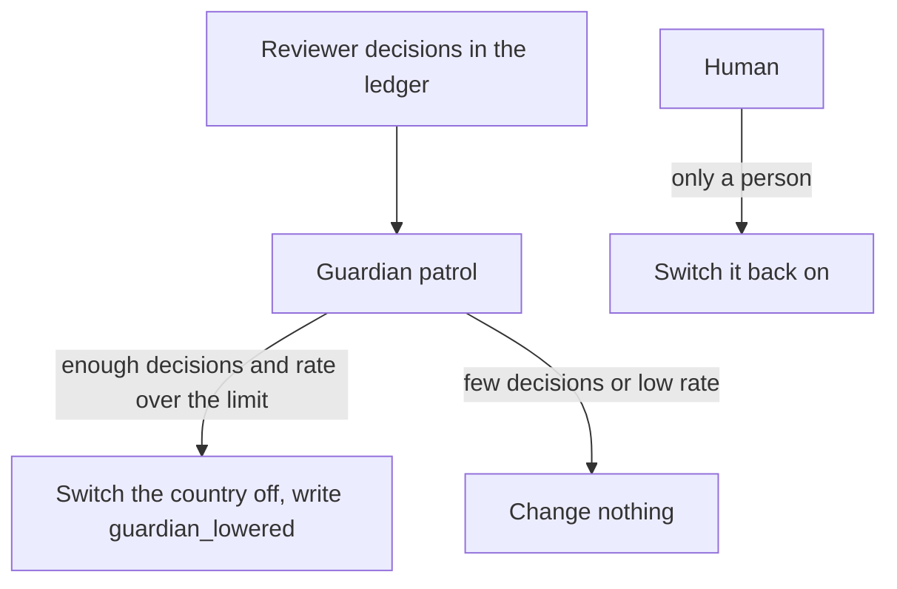
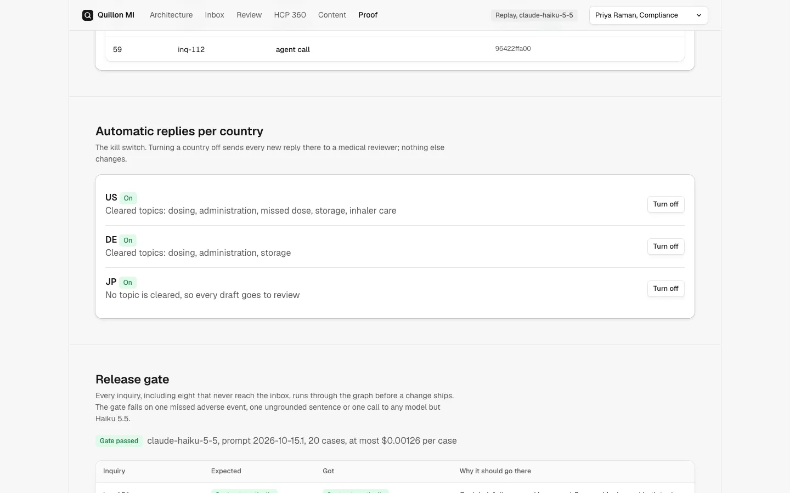

# Let the guardian only tighten

**The job:** reviewers in Germany reject most automatic drafts this week. The platform must stop sending
automatically there without waiting for a meeting, and it must never loosen anything by itself.

**Before:** a person notices the rejections, if anyone looks, and edits a setting.

**After:** a guardian reads the reviewers' decisions and can only switch a country off. Switching it back on
is a human act, and an improver can only write proposals (ADR 0026).

## What you will learn

- Explain why an automatic control may only tighten.
- Prove that a country is switched off on its own, and never back on.

## Prerequisites

Docker, [uv](https://docs.astral.sh/uv/) and `make up`. No API key.

## How it works



## Steps

1. Read the limits.
2. Look at each country's override rate.
3. Skip a country with too few decisions or a low rate.
4. Turn its auto replies off.
5. Write what was lowered to the ledger.

These are the `# Step` comments in `patrol`.

## Run it

```bash
make up
make lab N=let-the-guardian-only-tighten
```

Expect: `3 passed`

## See it in the console



Automatic replies per country. The guardian can turn a country off, only a person turns it on.

## Read

- `src/hcpagents/guardian.py`: `override_rates` and `patrol`.
- `src/hcpagents/improver.py`: proposals only.
- `docs/adr/0026-the-guardian-only-tightens-and-the-improver-only-proposes.md`.

## What the test proves

- Reviewers who reject too much switch one country off, and no other country.
- A spotless record never switches a country back on.
- Too few decisions change nothing.

## Break it, watch the test fail

In `src/hcpagents/guardian.py`, change `s | {"enabled": False}` to `s | {"enabled": True}`. The first test
fails: the guardian now loosens the country it was meant to tighten. Put it back.

## What production adds

A guardian per tenant and a window that starts at the last human change, so old rejections stop counting.

## Check yourself

<details>
<summary>Reviewers reject many drafts in one country. What does the guardian do?</summary>

It switches that country off and leaves the others alone.

</details>

<details>
<summary>A country has a spotless record. Does the guardian switch it back on?</summary>

No. Only a person can loosen a control.

</details>

## Try next

Pick a learner issue. Write the test that fails first, then fix it.

- [Every open learner issue](https://github.com/learnwithparam/enterprise-agentic-architecture/issues?q=is%3Aopen+label%3Aassignment)

## New words

- **guardian**: A watcher that may only make the rules stricter.
- **improver**: A helper that may only write proposals.
- **override rate**: The share of drafts that reviewers reject.
- **patrol**: One check of the recent reviewer decisions.
