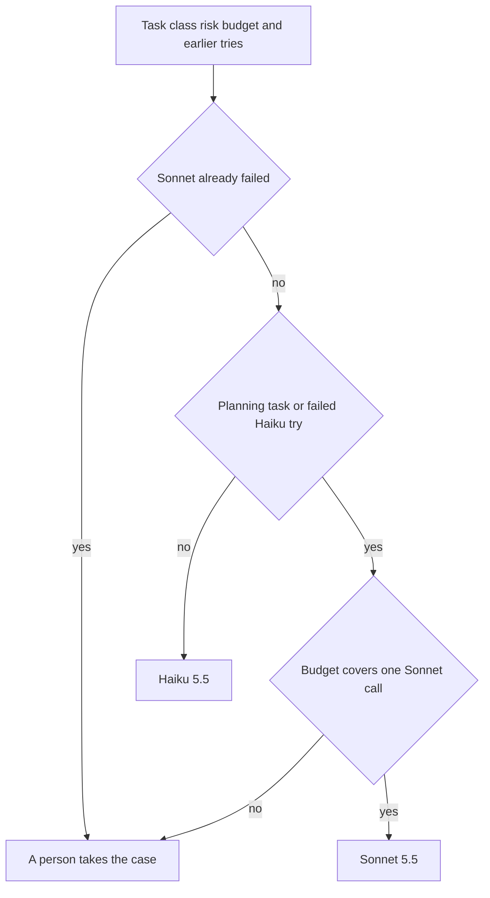
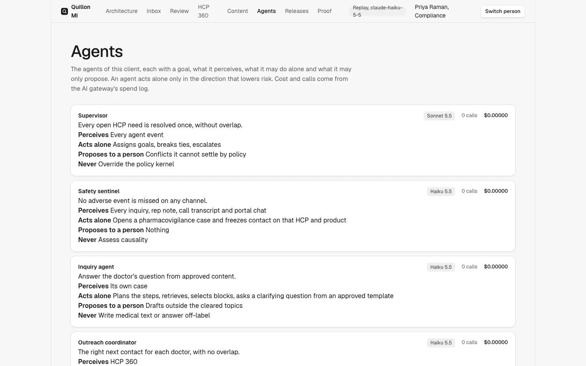

# Pick the model with a router

**The job:** Quillon's medical information service makes thousands of cheap calls, such as screening a message. It also makes a few hard ones (plan a multi-question reply, settle a conflict). Paying for the strong model
on every call wastes money, and using the cheap one for everything misses the hard cases.

**Before:** one model name in a config file. A schema failure retries the same model until the budget is
gone.

**After:** a pure function decides from the task class, the risk, the budget left on the case and what
earlier tries returned. Haiku 5.5 is the default, and Sonnet 5.5 takes planning and any failed Haiku try. After Sonnet fails or the budget runs out a person takes the case. It can only return one of two ids.

## What you will learn

- Trace how a call moves from Haiku to Sonnet to a person.
- Prove that no input ever picks a model outside the allowlist.

## Prerequisites

[uv](https://docs.astral.sh/uv/) only. No Floci or API key is needed.

## How it works



## Steps

1. Refuse a task or a risk that is not known.
2. A person takes the call once Sonnet has failed it.
3. Work out if an earlier try calls for Sonnet.
4. Narrow work stays on Haiku.
5. A person takes the call when the budget is too low for Sonnet.
6. Pick Sonnet and say why.

These are the `# Step` comments in `route`.

## Run it

```bash
make lab N=pick-the-model-with-a-router
```

Expect: 7 passed

## See it in the console



The agents screen. Each agent shows its model, its calls and its cost.

## Read

- `src/hcpagents/router.py`: `route`, the task classes and the budget floor.
- `docs/adr/0008-model-router.md` for why the router is a function and the gate runs it whole.

## What the test proves

- Each task class lands on the model the table says, and an unknown class is an error.
- A schema failure escalates exactly once, and a second failure goes to a person.
- A case without budget for a Sonnet call goes to a person instead of spending.
- No input produces a model outside the allowlist.

## Break it, watch the test fail

In `src/hcpagents/router.py`, change `if SONNET in tried:` to `if False:`. The two-failure test fails: a
case would loop on Sonnet forever instead of reaching a person. Put it back.

## What production adds

Every routing decision is traced with its reason. The AI gateway meters each call by tenant, agent
and release, so the cost of the router itself shows on the Releases page.

## Check yourself

<details>
<summary>A call fails its schema on Haiku, then again on Sonnet. What happens next?</summary>

The case goes to a person. It never loops on Sonnet.

</details>

<details>
<summary>A case has no budget left for a Sonnet call. What happens?</summary>

It goes to a person instead of spending.

</details>

## Try next

Pick a learner issue. Write the test that fails first, then fix it.

- [#27 Match the agent roster to the code](https://github.com/learnwithparam/enterprise-agentic-architecture/issues/27)
- [Every open learner issue](https://github.com/learnwithparam/enterprise-agentic-architecture/issues?q=is%3Aopen+label%3Aassignment)

## New words

- **router**: A function that picks which model handles a call.
- **task class**: The kind of job a call does, such as screening or planning.
- **escalate**: Move up to the stronger model.
- **allowlist**: The short list of models the system may call.
