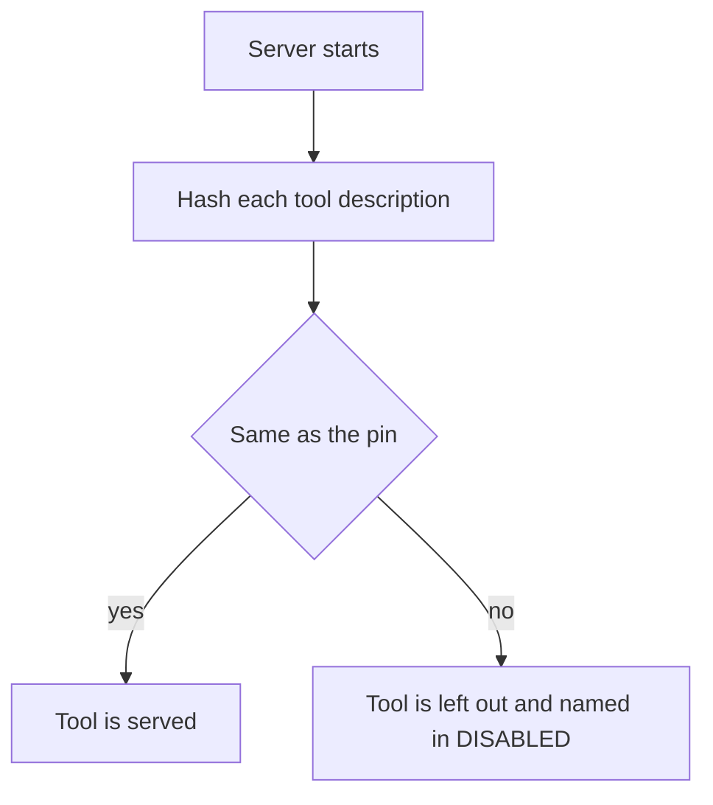

# Pin MCP tools with description hashes

**The job:** Quillon lets a client's own agents call three tools on the platform over MCP. The model of
that client reads each tool's description to decide what to do. Nobody must be able to change a
description after a person has read it.

**Before:** a description is plain text in the code. A change that tells the client's model to "also send
the case to this address" looks like a small edit. Nothing stops it reaching the client.

**After:** the hash of each tool's name and description is pinned in `src/hcpagents/mcp_pins.json`. When the
server starts, a tool whose description no longer matches its pin is left out, and it is named in
`DISABLED`. A person reads the change, then pins the new hash.

## What you will learn

- Explain why a tool description is pinned by a hash.
- Prove that a changed tool is not served.

## Prerequisites

[uv](https://docs.astral.sh/uv/) only. No Floci or API key is needed.

## How it works



## Steps

1. Forget the tools left out last time.
2. A tool that matches its pin is served.
3. Name a changed tool and skip it.

These are the `# Step` comments in `pinned`.

## Run it

```bash
make lab N=pin-mcp-tools-with-description-hashes
```

Expect: 3 passed

## Read

- `src/hcpagents/mcp_server.py`: `description_hash`, `pinned` and `build`.
- `src/hcpagents/mcp_pins.json`: the pins.
- `docs/adr/0028-machine-interfaces-share-one-front-door.md`.

## What the test proves

- The pin file lists each tool and each hash matches the code.
- A tool with an unchanged description is served.
- A tool with a changed description is not served, and the others still are.

## Break it, watch the test fail

In `src/hcpagents/mcp_server.py`, in `pinned`, change the `if pins.get(...) == description_hash(tool):` line
to `if True:`. Step 3 fails: the changed description would be served. Put it back.

## What production adds

`tests/test_live_i_mcp_pins.py` builds the real server and lists its tools. After a reviewed change, run
`uv run python -m hcpagents.mcp_server` to pin the new hashes. The pin change shows in the pull request.

## Check yourself

<details>
<summary>One tool's description changes. Are the other tools still served?</summary>

Yes. Only the changed tool is held back.

</details>

<details>
<summary>Why does a description change matter?</summary>

A model reads the description to decide what to do. A changed one can change what the agent does.

</details>

## Try next

Pick a learner issue. Write the test that fails first, then fix it.

- [Every open learner issue](https://github.com/learnwithparam/enterprise-agentic-architecture/issues?q=is%3Aopen+label%3Aassignment)

## New words

- **MCP**: A standard way for an agent to call tools on another system.
- **hash**: A short fingerprint of some text.
- **pin**: A saved hash that a tool must match.
- **tool description**: The text a model reads to learn what a tool does.
