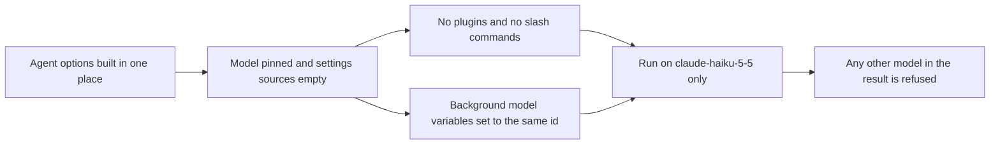

# Pin the model with Agent SDK options

**The job:** the eval gate passed on Claude Haiku 5.5. Production must run that exact model with that
exact prompt. Nothing from the machine it runs on may change what the agent can do. That means a
developer's `~/.claude` settings, plugins, MCP servers or slash commands. Nothing may change which model a
background call uses either.

**Before:** the Agent SDK starts the Claude Code runtime with whatever settings it finds. A plugin adds a
tool. A settings file switches the small model. So the run that passed the gate is not the run in
production.

**After:** `agents._options` builds every agent's `ClaudeAgentOptions` the same way. It has `model` pinned,
`setting_sources=[]`, `strict_mcp_config=True`, no plugins, slash commands disabled, built-in tools off. The background model environment variables are pinned to the same id. Every result is checked for the
models it used. The cost comes from the tokens, at Haiku 5.5 prices.

## What you will learn

- Prove that every agent runs on an allowed model with nothing loaded from your machine.
- Compute the bill for a call from its token counts.

## Prerequisites

[uv](https://docs.astral.sh/uv/) only. No Floci or API key is needed.

## How it works



## Steps

1. Find every model the run used that is not on the list.
2. Refuse the run and name those models.

These are the `# Step` comments in `check_models`.

## Run it

```bash
make lab N=pin-the-model-with-agent-sdk-options
```

Expect: 4 passed

## Read

- `src/hcpagents/agents.py`: `ALLOWED_MODELS`, `PRICES`, `_options`, `check_models`, `recording_key`, `Spend`.
- `docs/adr/0007-model-allowlist-and-isolated.md` and `docs/adr/0006-replay-recordings.md`.

## What the test proves

- All three agents run on `claude-haiku-5-5` with no local settings, plugins or stray MCP servers.
- A result that touched any other model is refused, in replay and live.
- Changing a system prompt changes the recording key, so an old recording cannot pass for the new prompt.
- The bill comes from token counts at $0.10 per million input and $0.50 per million output tokens.

## Break it, watch the test fail

In `src/hcpagents/agents.py`, change `setting_sources=[]` to `setting_sources=["user"]` and rerun the
lab. The isolation test fails: the agent would now load your own Claude settings. Put it back.

## What production adds

The same options are used with `CLAUDE_CODE_USE_BEDROCK=1` and a Bedrock inference profile for Haiku 5.5 in
the client's region. The spend cap per case and per session stays in code. The runtime's own budget is a
backstop, not the control.

## Check yourself

<details>
<summary>Why does a prompt change make old recordings useless?</summary>

The prompt is part of the recording key, so an old recording cannot pass for the new prompt.

</details>

<details>
<summary>What goes wrong if the agent loads your own Claude settings?</summary>

Your settings could change its model or tools, so the run is no longer the one we tested.

</details>

## Try next

Pick a learner issue. Write the test that fails first, then fix it.

- [#19 Test the container choice](https://github.com/learnwithparam/enterprise-agentic-architecture/issues/19)
- [Every open learner issue](https://github.com/learnwithparam/enterprise-agentic-architecture/issues?q=is%3Aopen+label%3Aassignment)

## New words

- **Agent SDK**: The kit that runs the Claude Code engine from your code.
- **pinned**: Fixed to one value so it cannot change.
- **setting sources**: The places where the engine looks for settings.
- **recording key**: The fingerprint that matches a saved run to its prompt.
