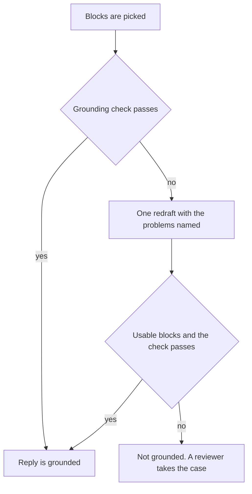

# Redraft a failed check once

**The job:** an agent picks approved blocks for a doctor's question. Sometimes the pick fails the grounding
check, for example because a block was withdrawn a minute ago. The system should try to fix it, and it should
not try forever.

**Before:** a failed check sends the case to a reviewer at once. A cheap fix that the model could have made
costs a person's time. The opposite risk is a loop that keeps asking the model until it says yes.

**After:** a failed check gets exactly one redraft. The model picks blocks again and is told what failed. The
same check reads the new pick. If it fails again, or the model returns no usable block, the case is not
grounded and the routing table sends it to a reviewer. The model never writes the reply. It only picks ids.

A refused pick is also told why. When the plan drops an id that no search returned for this product and
country, the next try names the refused id and says to choose only ids a search returns.

## Prerequisites

[uv](https://docs.astral.sh/uv/) only. No Floci or API key is needed.

## How it works



## Steps

1. Check the first reply.
2. If it fails, redraft once, told what failed.
3. Check the redraft. Its verdict stands.

These are the `# Step` comments in `verify_with_one_redraft`.

## Run it

```bash
make lab N=redraft-a-failed-check-once
```

Expect: 5 passed

## Read

- `src/hcpagents/agent_redraft.py`: `verify_with_one_redraft` and `usable_ids`.
- `src/hcpagents/plan.py`: `_prompt`, which adds the refused ids to a retry.

## What the test proves

- A grounded reply is never redrafted.
- A failed reply is redrafted once, and a second failure is not retried.
- A redraft that returns no usable block leaves the case ungrounded.
- A refused id is named in the next prompt, and a clean pick adds nothing.

## Break it, watch the test fail

In `src/hcpagents/agent_redraft.py`, change `if not new_ids:` to `if False:` and rerun the lab. The test for
no usable block fails: an empty redraft would be checked as a reply with no answer in it. Put it back.

## What production adds

`tests/test_live_g_redraft.py` runs a real case through the assembler agent. It checks that the redraft is
written to the ledger with its problems and that a failed redraft routes to a reviewer.
