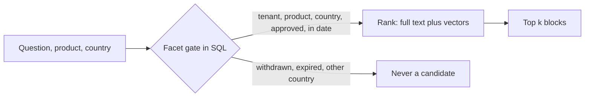

# Retrieve behind a facet gate

**The job:** a German doctor asks about storage. A block that was withdrawn last week quotes the exact
words of the question. It must never be the source of a reply.

**Before:** retrieval ranks everything and filters after. A strong match on withdrawn or foreign content wins.

**After:** product, country, approved status and validity dates are a hard filter in SQL. Ranking only orders
what the gate lets through (ADR 0012).

## Prerequisites

Docker, [uv](https://docs.astral.sh/uv/) and `make up`. The first run downloads the local embedding model,
about 220 MB. No API key.

## How it works



## Run it

```bash
make up
make lab N=retrieve-behind-a-facet-gate
```

Expect: `3 passed`

## Read

- `src/hcpagents/retrieval.py`: the `GATE` constant and `_rank`.
- `src/hcpagents/retrieval_eval.py` for the hybrid versus full text comparison.
- `docs/adr/0012-hybrid-retrieval-behind-a-hard-facet-gate.md`.

## What the test proves

- A withdrawn block is never returned, even when the question quotes it word for word.
- Another country's blocks are never returned, whatever the question says.
- Another tenant finds nothing.

## Break it, watch the test fail

In `src/hcpagents/retrieval.py`, delete the `AND d.doc ->> 'status' = 'approved'` line from `GATE`. The first
test fails: the withdrawn storage block is back in the results. Put it back.

## What production adds

A re-index on every content change, and a cache that forgets a block the moment it is withdrawn.
