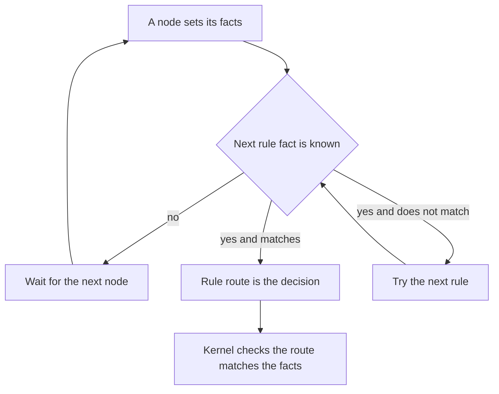
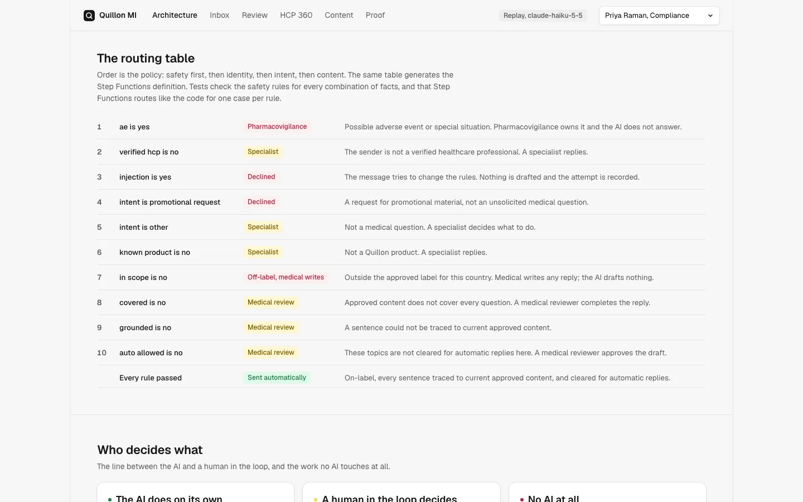

# Route inquiries with a routing table

**The job:** Quillon's medical information service gets questions from doctors on five channels. Each one
must reach the team that owns it. Pharmacovigilance gets a possible side effect, and medical gets an off-label
question. A reviewer gets anything not cleared. The doctor gets a direct reply only when every check
passed.

**Before:** a model decides where a message goes. Nobody can say what it will decide next time. An adverse
event phrased as a dosing question can be answered instead of reported.

**After:** the agents establish facts (`ae`, `in_scope`, `grounded` and so on). Plain code walks a fixed
table, and the first match wins. Compliance reads the table. Tests walk it.

## What you will learn

- Trace one inquiry through the routing table, rule by rule.
- Prove that the order of the rows is the policy.
- Explain why the model sets facts but never picks the route.

## Prerequisites

[uv](https://docs.astral.sh/uv/) only. No Floci or API key is needed.

## How it works



## Steps

1. Walk the rules in order.
2. Stop while a fact the rule needs is unknown.
3. The first rule that matches gives the route.
4. No rule matched, so the reply may be sent.

These are the `# Step` comments in `decide`.

## Run it

```bash
make lab N=route-inquiries-with-a-routing-table
```

Expect: 5 passed

## See it in the console



The routing table screen. Compliance reads the same rows the code walks.

## Read

- `src/hcpagents/graph.py`: `ROUTING`, `decide`, `run` and `asl`.
- `docs/adr/0001-fixed-graph-over-model-routing.md` for why the model never routes.

## What the test proves

- A message that is both an adverse event and an injection attempt goes to pharmacovigilance, because the
  adverse event row comes first.
- Any single fact going wrong keeps the reply from sending.
- The engine returns nothing while a fact it needs is unknown, so a node that has not run cannot be skipped.
- The Step Functions definition is generated from the same table, so production cannot drift from it.

## Break it, watch the test fail

In `src/hcpagents/graph.py`, move the `("injection", True, "decline", ...)` row above the `("ae", ...)` row
and rerun the lab. The adverse event test fails: a side effect wrapped in "ignore your instructions" would
be declined, and the legal report would never be filed. Put the row back.

## What production adds

The same `asl()` output is deployed as the Step Functions state machine, with each node a Lambda task.
`tests/test_graph.py` runs one case per rule through Step Functions on Floci and checks it routes like
Python.

## Check yourself

<details>
<summary>A message is an adverse event and also says "ignore your instructions". Where does it go?</summary>

To pharmacovigilance. The adverse event row comes first, and the first match wins.

</details>

<details>
<summary>Why does the engine return nothing while a fact is unknown?</summary>

So a step that has not run yet cannot be skipped. The case waits for the fact.

</details>

## Try next

Pick a learner issue. Write the test that fails first, then fix it.

- [#2 Accept email inquiries at the ingest door](https://github.com/learnwithparam/enterprise-agentic-architecture/issues/2)
- [#9 Add sample requests from field reps](https://github.com/learnwithparam/enterprise-agentic-architecture/issues/9)
- [#16 Measure how fast a question is routed](https://github.com/learnwithparam/enterprise-agentic-architecture/issues/16)
- [#18 Prove each ADR names a test that exists](https://github.com/learnwithparam/enterprise-agentic-architecture/issues/18)
- [Every open learner issue](https://github.com/learnwithparam/enterprise-agentic-architecture/issues?q=is%3Aopen+label%3Aassignment)

## New words

- **routing table**: A fixed list of rules where the first match wins.
- **pharmacovigilance**: The team that tracks drug side effects.
- **adverse event**: A side effect a patient may have had.
- **Step Functions**: The AWS service that runs a fixed flow of steps.
