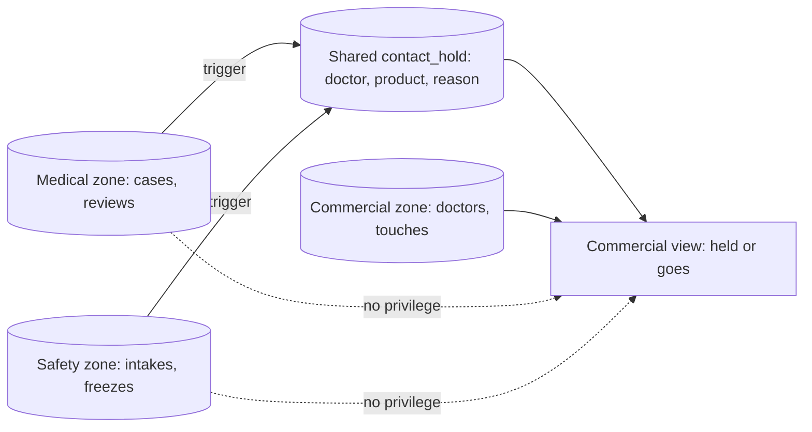
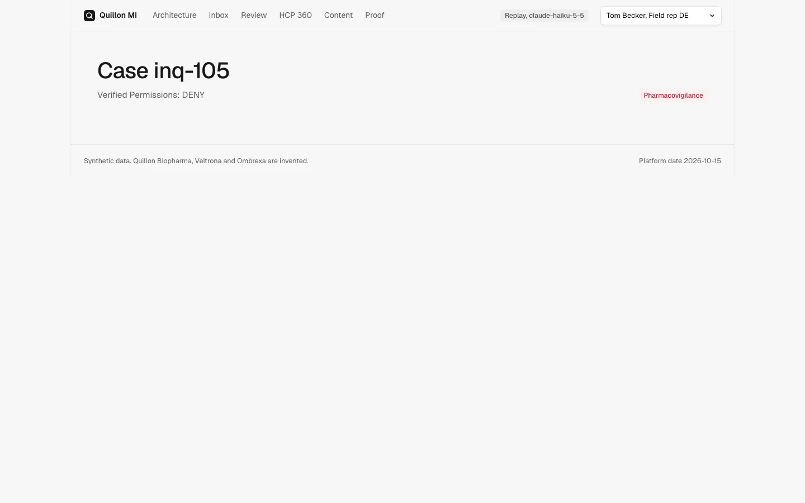

# Split data into zones

**The job:** marketing at Quillon asks "may we email this doctor?". The answer must not leak that the doctor
has an open medical question, which product it is about, or what the doctor reported.

**Before:** every team read the same tables. The marketing view showed medical case ids and counts, and
nothing but a code review kept it from showing more.

**After:** medical, commercial and safety data live in separate database schemas, each with its own login.
The commercial login has no privilege on the other two. The only thing that crosses is a hold: a doctor, a
product and a reason, with no case id and no text. The database writes the hold itself, so no code path can
put a case id into it.

Cedar decides who gets the medical view.

## What you will learn

- Explain the three data zones and who may read each.
- Prove that marketing sees a hold, never the case behind it.

## Prerequisites

Docker, [uv](https://docs.astral.sh/uv/) and `make up` (Postgres and Floci). No API key.

## How it works



## Run it

```bash
make up
make lab N=split-data-into-zones
```

Expect: `4 passed`

## See it in the console



A field rep cannot read case detail. The commercial view hides the medical case.

## Read

- `migrations/008_zones.sql`: the schemas, the roles, the policies and the two trigger functions.
- `src/hcpagents/views.py`: the commercial view and `view_for`.
- `policies/cedar/zones.cedar`: who gets the medical view.
- `src/hcpagents/store.py`: which kind of document lives in which zone.

## What the test proves

- The commercial login is refused on the medical and safety zones, for reads and for writes.
- An open case holds a promotion, and the commercial view never contains the case id or the text.
- Closing the last open case lifts the hold, and no login can write a hold directly.
- A field rep gets the commercial view and a medical reviewer gets the medical one.

## Break it, watch the test fail

In `src/hcpagents/views.py`, change `if allowed:` in `view_for` to `if True:`. The last test fails: a field
rep is handed the medical view. Put it back.

## What production adds

Separate AWS accounts for the zones, one KMS key for each zone (the stack already makes them), and an audit
of every cross-zone read. This build separates the zones inside one database cluster.

## Check yourself

<details>
<summary>A doctor has an open medical case. What does marketing see?</summary>

That contact is on hold. Never the case id or its text.

</details>

<details>
<summary>Can any login write a hold directly?</summary>

No. Only closing the last open case lifts it.

</details>

## Try next

Pick a learner issue. Write the test that fails first, then fix it.

- [#3 Give the chatbot its own ingest channel](https://github.com/learnwithparam/enterprise-agentic-architecture/issues/3)
- [#29 Prove each known limit is still true](https://github.com/learnwithparam/enterprise-agentic-architecture/issues/29)
- [Every open learner issue](https://github.com/learnwithparam/enterprise-agentic-architecture/issues?q=is%3Aopen+label%3Aassignment)

## New words

- **zone**: A group of data with its own schema, login and key.
- **hold**: A fact that contact is paused, without saying why in medical terms.
- **trigger**: A rule inside the database that runs when a row changes.
