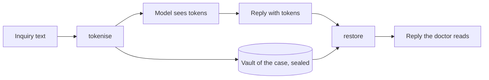

# Tokenise PHI with a vault

**The job:** a doctor writes to Quillon's medical information service with a name, a registry id and a
phone number in the text. A model drafts the reply. The model must never see who the doctor is, and the
doctor must still get a reply that names them.

**Before:** the inquiry goes to the model as it is. The name and the phone number sit in the prompt, in the
provider's logs and in every trace.

**After:** before the model reads the text, each name, id, email and phone number becomes a token such as
`[NAME_1]`. The real values wait in a vault for that one case. When the reply comes back, the tokens are
swapped for the real values. The vault is sealed with a key of the tenant, so another tenant cannot open it.

## Prerequisites

[uv](https://docs.astral.sh/uv/) only. No Floci or API key is needed. The sealing and the tenant wall are
proved on Floci in `tests/test_live_i_phi_vault.py`.

## How it works



## Steps

1. Step 1: the model sees tokens and no personal value.
2. Step 2: one person is one token everywhere in the case.
3. Step 3: the reply is restored from the vault of the case.
4. Step 4: a token that is not in this vault stays a token.

## Run it

```bash
make lab N=tokenise-phi-with-a-vault
```

Expect: 4 passed

## Read

- `src/hcpagents/phi_vault.py`: `tokenise`, `restore`, `swap_out` and `swap_back`.
- `src/hcpagents/privacy.py`: the tenant key that seals the vault.

## What the test proves

- No name, registry id or phone number is left in the text the model reads.
- The same value always gets the same token inside one case.
- Swapping back gives the original text, character for character.
- A vault knows only its own tokens.

## Break it, watch the test fail

In `src/hcpagents/phi_vault.py`, in `swap_out`, change the line that swaps phone numbers to `text = text`.
Step 1 fails: a phone number would reach the model. Put it back.

## What production adds

The vault is a row in the tenant's own table, sealed with AES-GCM under a key kept in SSM for that case.
Delete the key and the vault cannot be read. A second tenant with the same case id gets nothing back.
