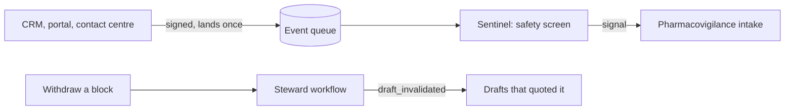

# Watch with the sentinel and the steward

**The job:** a field rep writes "patient developed a rash" in a CRM note. Nobody asked a question, but a
legal reporting clock has started. And when Legal withdraws a content block, every draft that quoted it
must stop being sendable.

**Before:** both depend on someone remembering to look.

**After:** a sentinel reads every channel on its own and raises a safety signal once per event. A steward
watches content and invalidates drafts the moment a block is withdrawn (ADR 0018 and 0024).

## Prerequisites

Docker, [uv](https://docs.astral.sh/uv/) and `make up` (Postgres, Floci and Temporal). No API key.

## How it works



## Run it

```bash
make up
make lab N=watch-with-the-sentinel-and-steward
```

Expect: `3 passed`

## Read

- `src/hcpagents/sentinel.py` and `src/hcpagents/events.py`.
- `src/hcpagents/workflows.py`: `ContentStewardWorkflow`.
- `docs/adr/0018-a-steward-watches-content-and-a-cache-only-ever-forgets.md` and `docs/adr/0024-the-sentinel-reads-every-channel.md`.

## What the test proves

- A rash in a rep's note reaches pharmacovigilance, and nobody called anything.
- Reading the same event twice raises one signal.
- Withdrawing a block makes the steward invalidate the draft that quoted it, so approval is blocked.

## Break it, watch the test fail

In `src/hcpagents/sentinel.py`, change `hits = rules.safety_screen(row["body"]) if row else []` to
`hits = []`. The first test fails: the rash note is read and nothing reaches pharmacovigilance. Put it back.

## What production adds

Per tenant queues, a dead letter queue for events that keep failing, and an alarm on the dead letters.
